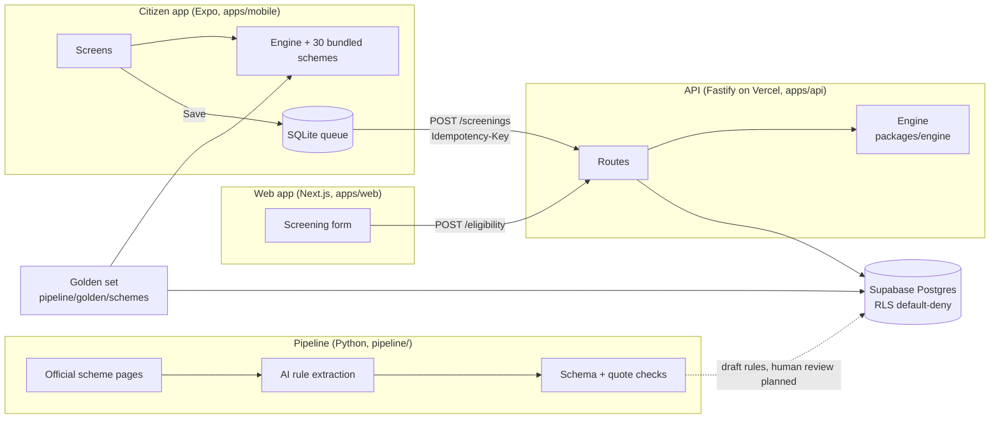
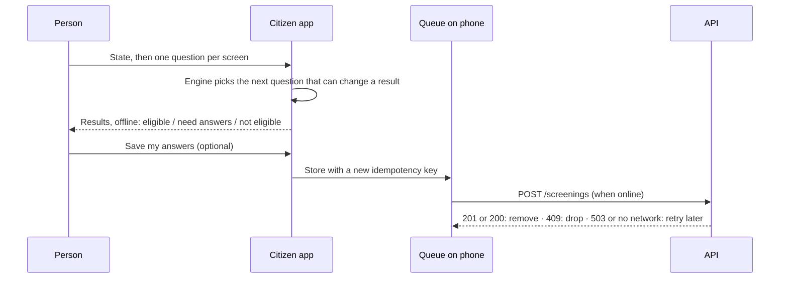
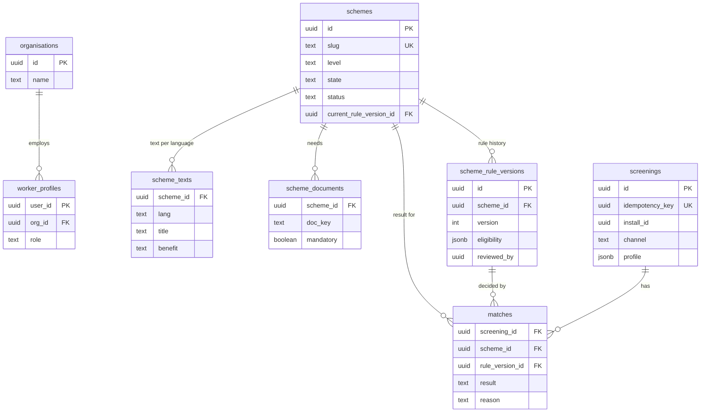

# SchemeMatch

SchemeMatch tells Indian citizens, in their own language, which government welfare schemes they are likely eligible for, why, and where to apply. It is built for people like Sunita, a widow in Maharashtra on a patchy phone network, and for the field workers who help families like hers.

> **Testing only.** The scheme rules were drafted from official pages and checked by AI, **not yet reviewed by a person**. Results are guidance ("you are likely eligible, please confirm at the office"), never a government decision. SchemeMatch is not an official government app.

| | Link |
|---|---|
| Web app for field workers (English + Bengali) | https://schemematch-web-zakuroooos-projects.vercel.app |
| Staging API | https://schemematch-api-zakuroooos-projects.vercel.app/schemes |
| The whole story, in simple English | [docs/STORY.md](docs/STORY.md) |
| Build log: how every step was built and checked | [docs/PROGRESS.md](docs/PROGRESS.md) |
| Design docs (PRD, architecture, privacy, ADRs) | [docs/00-README.md](docs/00-README.md) |

## What it does

- **Three-valued answers.** Every scheme comes out PASS, FAIL or UNKNOWN. "Don't know" is never treated as "no", so nobody is wrongly told they don't qualify.
- **Only asks what matters.** After each answer the engine picks the question that can still change a result. Sunita's walk-through takes 9 questions, not 16, to reach her 11 schemes.
- **Works offline on the phone.** The citizen app carries the engine and all 30 schemes inside it. Checked on a real Android phone in airplane mode.
- **Saves only when asked, and never twice.** A saved screening waits in a queue on the phone and is sent with an idempotency key, so a retry on a weak network can never create a duplicate. "Delete my data" clears the phone and the server.
- **English and Bengali** in the web app and the citizen app.

## Architecture



| Part | Where | What |
|---|---|---|
| Engine | [packages/engine](packages/engine) | Pure TypeScript, three-valued logic, 100% code coverage enforced in CI |
| API | [apps/api](apps/api) | `/schemes`, `/eligibility`, `POST`/`DELETE /screenings`; strict input (Zod), rate limit, no answers in logs |
| Web app | [apps/web](apps/web) | Next.js, English + Bengali, Playwright end-to-end tests with axe accessibility checks |
| Citizen app | [apps/mobile](apps/mobile) | Expo SDK 57, fully offline, saved screenings sync later |
| AI pipeline | [pipeline](pipeline) | Drafts rules from official pages; never runs at request time |
| Database | [supabase/migrations](supabase/migrations) | Postgres with row-level security; pgTAP tests |

## Screening flow



## Database (Supabase)



Screenings hold no name, phone or ID number. The public keys cannot read or write them (tested).

## Scheme data

- **30 golden schemes** in [pipeline/golden/schemes](pipeline/golden/schemes): 15 central, 6 Maharashtra, 9 West Bengal. Each rule quotes the official page it came from; the saved pages are in [pipeline/sources](pipeline/sources).
- **10 held-out schemes** in [pipeline/golden/heldout](pipeline/golden/heldout), used once to score the AI pipeline fairly.
- Drafted from official pages and AI-checked. **Human review: 0 of 30 so far.**

## Honest limits

- The rules are **not yet reviewed by a person**.
- AI rule extraction scores **F1 0.53** on the 10 held-out schemes it never saw (target 0.90): [report](reports/eval-2026-10-21-heldout.md).
- Required documents are listed for only **2 of the 30** schemes.
- **Staging has no database yet**, so saving answers "not set up" (503). The app keeps saved screenings on the phone and retries.
- **No read-aloud or voice yet.**
- Scheme names and details are in **English only**; the questions and screens are English and Bengali.
- The citizen app's sync was tested with automated tests only; the check on a real phone is pending.

## Tests

| Part | Tests | Run |
|---|---|---|
| Engine | 573 (100% coverage) | `pnpm turbo run test` |
| API | 67, plus 7 that need a database | same; the 7 run in CI's database job |
| Web | 18 unit + 18 browser end-to-end | `pnpm --filter @schemematch/web e2e` for the browser tests |
| Citizen app | 73 | `pnpm --filter @schemematch/mobile test` |
| Database | 38 (pgTAP) | `supabase test db` |
| Pipeline | 52 | `cd pipeline && uv run pytest` |

## Run it locally

```bash
pnpm install
pnpm turbo run lint typecheck test   # everything CI runs for TypeScript
pnpm --filter @schemematch/mobile start   # the citizen app (Expo)
```

Setup for the API, database and deploys: [docs/RUNBOOK.md](docs/RUNBOOK.md).

## Screenshots

Only real screenshots go here. The list of shots still to capture is in [docs/screenshots/README.md](docs/screenshots/README.md).

## Safety

Packages must be at least 14 days old (pnpm `minimumReleaseAge`), CI blocks high and critical audit findings, and secrets live only in Vercel and Supabase settings. Details: [docs/PRIVACY-SECURITY.md](docs/PRIVACY-SECURITY.md).
