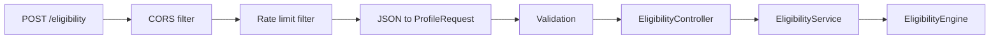

# Is module ko samjho (Hinglish)

English: [LEARN.md](LEARN.md). 26 Nov ke baad, thoda thoda padho. Ek part mein 10–15 minute.

## 1. Ye kya hai, ek line mein?

Ye ek Java program hai. Insaan ke answers leta hai aur batata hai kaunsi sarkari schemes mil sakti hain.

## 2. Mujhe kyun padhna hai?

Lowe's ko Spring chahiye. Resume par Spring hai, to wo code khulwa kar live change karwa sakte hain.

**Sach aise bolo:** "I first built this API in TypeScript. I rebuilt it in Spring Boot with AI help,
with the old test cases as my check. I can explain and change any part." Aakhri line tabhi bolo jab
part 13 ki exercises khud kar lo.

## 3. Real example: Swiggy

Tum order karte ho. **Guard** dekhta hai spam to nahi. **Waiter** order leta hai. **Chef** pakata hai.
**Store keeper** saaman laata hai. Kuch toota to **manager** sorry bolta hai.

| Restaurant | Hamara code | Kaam |
| --- | --- | --- |
| Guard | Filter | Sabse pehle chalta hai, request rok sakta hai |
| Order form check | Validation | Galat answer mana karta hai |
| Waiter | Controller | HTTP padhta aur bhejta hai |
| Chef | Service | Decide karta hai kya karna hai |
| Store keeper | Repository | Data padhta aur save karta hai |
| Manager | Exception handler | Error ko saaf JSON banata hai |

## 4. Naye words

- **HTTP** (= browser aur server ki bhasha).
- **API** (= program jise doosre program call karte hain). **Route** (= API ka ek address, jaise `/schemes`).
- **JSON** (= text data, jaise `{"age":30}`).
- **Spring** (= Java toolkit jo objects banata aur jodta hai).
- **Spring Boot** (= Spring + ready settings + andar hi server).
- **Bean** (= object jo Spring banata aur sambhalta hai).
- **Annotation** (= label jaise `@Service`, jo Spring ko batata hai kya karna hai).
- **Profile** (= app ka mode). Dhyan: insaan ke answers ko bhi hum profile bolte hain.
- **Maven** (= library download, build aur test ka tool). `mvnw` = Maven ka apna installer script.

## 5. Ek request, step by step



**Diagram kaise padhein, arrow by arrow**

1. Request `WebCorsFilter` par aati hai. **CORS** (= browser ka rule: kaunsa web page answer padh sakta hai).
2. `RateLimitFilter` ginta hai. Ek minute mein zyada to **429** (= bahut requests).
3. **Jackson** (= JSON library) text ko `ProfileRequest` object banata hai. Unknown key par 400.
4. Bean Validation range dekhta hai. Age 150 par **400** (= request galat hai).
5. Controller service ko call karta hai.
6. Service repository se schemes maangti hai.
7. Har scheme par engine chalta hai. Controller **200** (= sab theek) ke saath JSON deta hai.

## 6. Engine, example ke saath

Har rule ka result **PASS**, **FAIL** ya **UNKNOWN**. UNKNOWN matlab "abhi pata nahi", "na" nahi.

Rule: `age >= 60 AND (BPL card OR income <= 21000)`. **BPL** (= below poverty line).

| Answers | age | card OR income | Result | Kyun |
| --- | --- | --- | --- | --- |
| age 65, card hai | PASS | PASS | PASS | dono pass |
| age 50 | FAIL | UNKNOWN | FAIL | AND mein ek FAIL kaafi |
| age 65 | PASS | UNKNOWN | UNKNOWN | card ya income chahiye |

```java
static Tri allOf(Collection<Tri> results) {    // kai results ka AND
    if (results.contains(FAIL)) return FAIL;   // ek bhi FAIL: poora FAIL
    if (results.contains(UNKNOWN)) return UNKNOWN; // FAIL nahi, par kuch pata nahi
    return PASS;                               // sab pass
}
```

## 7. Dependency injection

**Dependency injection** (= jo chahiye wo maango; koi aur la kar dega).

```java
@Service                                              // Spring: is class ka ek object banao
public class EligibilityService {
    private final SchemeRepository schemes;           // ise kya chahiye: ek interface
    public EligibilityService(SchemeRepository s) {   // Spring yahan de deta hai
        this.schemes = s;
    }
}
```

`SchemeRepository` ek **interface** hai (= methods ka vaada, code nahi). Do class ise nibhati hain:
`BundledSchemeRepository` (file) aur `PostgresSchemeRepository` (database). Spring profile ek chunta
hai. Service nahi badalti. Test mein fake de sakte ho.

`ScreeningRepository` sirf database ke saath hota hai. Isliye service `Optional<ScreeningRepository>`
maangti hai. Khaali ho to save par **503** (= service available nahi). Database band ho to bhi 503: baad mein wahi
request chal sakti hai.

## 8. Saare annotations

| Annotation | Yahan matlab |
| --- | --- |
| `@SpringBootApplication` | Yahan se start; is package ke beans dhoondo; ready settings |
| `@ConfigurationPropertiesScan` | Settings wali classes dhoondo |
| `@ConfigurationProperties`, `@DefaultValue` | `schemematch.*` se `AppProperties` bharo; na ho to default |
| `@Configuration`, `@Bean` | Beans banane wali class; is method ka result bean hai |
| `@Component` | Aam bean (filters, seeder) |
| `@Service`, `@Repository` | Logic wala bean; data wala bean (SQL error ko Spring error banata hai) |
| `@Profile("postgres")` | Sirf is mode mein bean banao |
| `@RestController` | Methods HTTP ka jawab JSON mein dete hain |
| `@RequestMapping`, `@GetMapping`, `@PostMapping`, `@DeleteMapping` | Kaunsa address aur method |
| `@RequestBody`, `@RequestHeader`, `@RequestParam` | Value body, header ya query se lo |
| `@Valid` | Is object ke rules check karo |
| `@NotNull`, `@Min`, `@Max`, `@DecimalMin`, `@DecimalMax`, `@Size`, `@Pattern` | Rules |
| `@UuidText` | Hamara apna rule, `@Pattern` se bana |
| `@Constraint`, `@ReportAsSingleViolation`, `@Target`, `@Retention` | Apna rule banane ke liye zaroori |
| `@RestControllerAdvice`, `@ExceptionHandler` | Sab controllers ki error handling; ye method ye error sambhalta hai |
| `@JsonInclude` | `details` null ho to mat dikhao |
| `@Transactional` | Method ka sab save ho, ya kuch bhi nahi |
| `@Order` | Kaunsa filter pehle |
| `@Override` | Java: parent ka method badal rahe hain |
| Tests: `@Test`, `@ParameterizedTest`, `@CsvSource`, `@ValueSource`, `@MethodSource` | Ek test; wahi test kai inputs par; inputs kahan se |
| Tests: `@BeforeEach`, `@ExtendWith` | Har test se pehle; helper jodo (yahan log pakadna) |
| Tests: `@SpringBootTest`, `@WebMvcTest`, `@AutoConfigureMockMvc` | Poori app; sirf web part; MockMvc do |
| Tests: `@Autowired`, `@MockitoBean`, `@Import`, `@TestConfiguration` | Bean do; fake lagao; test beans jodo |
| Tests: `@EnableConfigurationProperties`, `@DynamicPropertySource`, `@ActiveProfiles` | Settings load; run time par setting; mode chuno |
| Tests: `@ServiceConnection`, `@LocalServerPort` | App ko container se jodo; port batao |
| `@SuppressWarnings` | Ek compiler warning chhupao (test helper) |

## 9. Validation

Jackson by default naram hai. Extra key ignore karta hai, `"38"` ko 38 bana deta hai. Hamare liye ye bug
hai: extra key kisi ka naam ho sakti hai. `StrictJsonConfig` ye band karta hai.

Do step: pehle **shape** (Jackson): int hai? key pata hai? Phir **range** (Bean Validation): age 0 se
120? Error field ka naam batata hai, value kabhi nahi dohrata.

## 10. Transaction aur ek hi baar save

**Transaction** (= database steps ka group: sab hon, ya koi nahi). Ek screening = 1 row + 30 match rows.
Match 17 fail hua to `@Transactional` sab hata deta hai (**rollback** = wapas).

**Idempotent** (= do baar karna = ek baar karna). UPI socho: Pay dabaya, network gaya, phir dabaya. Do
baar paisa nahi katna chahiye. Phone ek **idempotency key** (= is kaam ki random id) banata hai aur har
retry mein wahi bhejta hai.

1. `insert ... on conflict (idempotency_key) do nothing returning id`.
2. Id mili: hum pehle hain. Matches save karo. **201** (= ban gaya).
3. Id nahi mili: pehle se saved. **Request hash** (= answers ka fingerprint) milao.
4. Hash same: purana result, 200. Hash alag: **409** (= takraav).

"Pehle select, phir insert" kyun nahi? Do requests dono "kuch nahi hai" dekh kar dono insert kar sakti
hain. Ye **race condition** hai (= result is par ki kaun tez hai). Unique constraint database mein hai,
isliye dono ka check ek hi jagah hota hai.

**`@Transactional` trap:** Spring bean ko lapet kar kaam karta hai. Usi class ke andar se call
(`this.save()`) wrapper chhod deti hai. Default mein sirf RuntimeException par rollback hota hai.

## 11. Teen tarah ke tests

| | Kya start hota hai | Kis liye | Example |
| --- | --- | --- | --- |
| Sirf **JUnit** | Sirf tumhari class | Logic, bahut tez | `ConditionTest`, `RateLimitFilterTest` |
| **MockMvc** | Spring, asli network nahi | Routes, status, JSON | `SchemeRoutesTest` |
| **Testcontainers** | Docker mein asli PostgreSQL, asli port | SQL, constraint, race | `PostgresIT` |

- `Test` wali files `./mvnw test` mein. `IT` (= integration test) wali `./mvnw verify` mein.
- **Parity test** (= dono engine ka same answer): TypeScript engine ke apne cases padhta hai.
- **Mutation check** (= jaan-boojh kar code todo; test fail hona chahiye). Saat baar toda; sab pakde gaye.
- Log wala break `PostgresIT` ne pakda. MockMvc log test ki memory khatam hui, usne wahan kuch sabit nahi kiya.

> **Boot 3 tutorials se farq.** Starter `spring-boot-starter-webmvc` hai, `-web` nahi. Jackson 3 ka
> package `tools.jackson` hai (uske annotations ka purana naam hai). `@MockBean` nahi, `@MockitoBean`.
> Test imports ke package badle. Testcontainers 2: `org.testcontainers.postgresql`. JUnit 6.0.3 hai;
> test likhne ka tareeka JUnit 5 jaisa hi hai.

### File aur line map

Sab `src/main/java/in/schemematch/api/` mein.

| Kya | File:line |
| --- | --- |
| Route that checks eligibility | `controller/EligibilityController.java:20` |
| Route that saves | `controller/ScreeningController.java:37` |
| Profile rules | `web/ProfileRequest.java:17` |
| Strict JSON | `config/StrictJsonConfig.java:22` |
| Error handling | `web/ApiExceptionHandler.java:32` |
| 409 handler | `web/ApiExceptionHandler.java:121` |
| Rate limit count | `web/RateLimitFilter.java:72` |
| Run engine on all schemes | `service/EligibilityService.java:32` |
| 503 when no database | `service/ScreeningService.java:29` |
| Interface | `repository/SchemeRepository.java:7` |
| Transaction and insert | `repository/PostgresScreeningRepository.java:33` |
| One rule check | `engine/Condition.java:44` |
| AND and OR | `engine/Tri.java:14` |
| One scheme | `engine/EligibilityEngine.java:26` |
| Next question | `engine/EligibilityEngine.java:53` |

### Interview mein kaise bolein

"A request passes two filters, then strict JSON parsing and Bean Validation. The controller calls a
service, which runs a plain Java rule engine. Schemes come from a repository interface with a file and
a PostgreSQL version, chosen by profile. Saving is idempotent through a unique constraint, and I tested
it with 20 parallel requests on a real database."

### Common galtiyan

- Ye live hai bolna. Live API Fastify hai.
- "JUnit 5" bolna. 6.0.3 hai.
- `synchronized` se duplicate save rukega bolna. Wo ek process mein hi chalta hai. Database ko rokna hai.
- Rate limit kai servers par chalega bolna. Ginti ek process mein hai.

### 3 check questions

1. Age nahi di. Age ka rule FAIL dega?
2. Unique constraint database mein kyun?
3. Rollback kaunsa test sabit karta hai?

<details><summary>Show answer</summary>

1. Nahi, UNKNOWN. 2. Do request ya do server, dono Java check paar kar sakte hain. 3.
`PostgresIT.oneBadMatchRollsBackTheWholeScreening`.

</details>

## 12. 20 interview questions

1. **What is Spring Boot?** Spring + ready settings + andar server. `main` chalao, API chalu.
2. **What is a bean?** Object jo Spring banata hai. Default mein poori app mein ek (singleton).
3. **Why constructor injection?** Field `final`, zaroorat saaf dikhti hai, test mein bina Spring fake de sakte hain.
4. **Controller vs service vs repository?** HTTP, decision, data. Teeno alag badal aur test sakte hain.
5. **`@Component` vs `@Service` vs `@Repository`?** Sab bean. Naam role batata hai; `@Repository` SQL errors bhi badalta hai.
6. **How do two repositories not clash?** `@Profile("postgres")` aur `@Profile("!postgres")`: ek hi banta hai.
7. **How does validation work?** Rules `ProfileRequest` par; `@Valid` chalata hai; handler 400 deta hai.
8. **Why refuse unknown keys?** Privacy. Galti se naam ya Aadhaar na aaye.
9. **Filter vs controller?** Filter routing se pehle har request dekhta hai. Limit aur CORS ke liye.
10. **What is 409 here?** Same key, alag answers.
11. **How is saving idempotent?** Unique key, `on conflict do nothing`, hash milana.
12. **What if two retries arrive together?** Doosra insert pehle ke commit ka wait karta hai, row nahi milti, saved wali padhta hai.
13. **What does `@Transactional` do?** Shuru, success par commit, RuntimeException par rollback.
14. **Why is it on the repository?** Ek save ka saara SQL wahin hai. Rules chalte waqt connection nahi rukta; bina database transaction chahiye hi nahi.
15. **When does `@Transactional` not work?** Self-call, private method, ya exception nigal li.
16. **Why Flyway?** Database changes versioned files hain; order mein, ek baar. Sirf local schema.
17. **MockMvc vs Testcontainers?** MockMvc: network nahi, asli SQL nahi. Testcontainers: asli PostgreSQL, dheema.
18. **Why `synchronized` in the rate limiter?** Padho, ek jodo, likho: ek saath hona chahiye, warna ginti khoti hai.
19. **How do you keep profiles out of logs?** Redacted `toString`, exception message nahi, loggers shaant, TRACE par tests.
20. **What would you improve?** Shared rate limit (Redis), schemes cache, Fastify se HTTP answers saath mein milana.

## 13. 5 chhote changes, khud karo

Pehle branch banao. Failing test, phir code, phir `./mvnw test`.

1. **`/version`:** `GET /version` jo `{"version":"0.1.0"}` de. MockMvc test.
2. **Age limit:** max age 110 karo. Kaunse tests batate hain? 110 aur 111 ka test jodo.
3. **Naya filter:** `/schemes` mein `?level=central`. Galat value par 400. Unknown-query check badlo.
4. **Naya operator:** `Condition` mein `starts_with`. Pass, fail, unknown test karo.
5. **Answer mein ginti:** `/eligibility` response mein `eligible_count` jodo.

## Bas itna yaad rakho

1. Filter → validation → controller → service → engine aur repository.
2. Answer nahi diya = UNKNOWN, FAIL nahi.
3. Interface + Spring profile file ko PostgreSQL se badal deta hai.
4. Database ka unique constraint ek hi baar save karwata hai.
5. Logic: JUnit. Routes: MockMvc. Asli SQL: Testcontainers.
