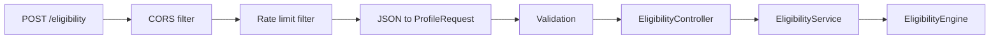

# Learn this module

Hinglish: [LEARN.hi.md](LEARN.hi.md). Read it in parts, after 26 Nov. One part takes 10–15 minutes.

## 1. What is this, in one sentence?

It is a Java program that takes a person's answers and returns the government schemes they may get.

## 2. Why should I care?

Lowe's asks for Spring. If it is on your resume, they can ask you to open it and change it live.

**Say this honestly:** "I first built this API in TypeScript. I rebuilt it in Spring Boot with AI
help, with the old test cases as my check. I can explain and change any part." Say the last sentence
only after you finish the exercises in part 13.

## 3. A real-life example: Swiggy

You place an order. The **guard** checks you are not a spammer. The **waiter** takes the order. The
**chef** cooks. The **store keeper** brings items. If something breaks, the **manager** says sorry.

| Restaurant | Our code | Job |
| --- | --- | --- |
| Guard | Filter | Runs first, can stop the request |
| Order form check | Validation | Refuses wrong answers |
| Waiter | Controller | Reads HTTP, sends HTTP |
| Chef | Service | Decides what must happen |
| Store keeper | Repository | Reads and saves data |
| Manager | Exception handler | Turns errors into neat JSON |

## 4. New words

- **HTTP** (= the language browsers and servers use to talk).
- **API** (= a program that other programs call). **Route** (= one address of the API, like `/schemes`).
- **JSON** (= text data like `{"age":30}`).
- **Spring** (= a Java toolkit that creates and connects your objects).
- **Spring Boot** (= Spring with ready settings and a built-in server).
- **Bean** (= an object that Spring creates and keeps).
- **Annotation** (= a label like `@Service` that tells Spring what to do).
- **Profile** (= a named mode of the app). Careful: we also call a person's answers a profile.
- **Maven** (= tool that downloads libraries, builds and tests). `mvnw` is Maven's own installer script.

## 5. One request, step by step



**How to read this diagram, arrow by arrow**

1. The request reaches `WebCorsFilter`. **CORS** (= a browser rule about which web pages may read us).
2. `RateLimitFilter` counts it. Too many in one minute gives **429** (= too many requests).
3. **Jackson** (= the JSON library) turns text into a `ProfileRequest` object. An unknown key gives 400.
4. Bean Validation checks ranges. Age 150 gives **400** (= your request is wrong).
5. The controller calls the service.
6. The service asks the repository for schemes.
7. It runs the engine on each one. The controller returns JSON with **200** (= fine).

## 6. The engine, with an example

Each rule gives **PASS**, **FAIL** or **UNKNOWN**. UNKNOWN means "not answered yet", not "no".

Rule: `age >= 60 AND (has BPL card OR income <= 21000)`. **BPL** (= below poverty line).

| Answers | age | card OR income | Result | Why |
| --- | --- | --- | --- | --- |
| age 65, card yes | PASS | PASS | PASS | both passed |
| age 50 | FAIL | UNKNOWN | FAIL | in AND, one FAIL decides |
| age 65 | PASS | UNKNOWN | UNKNOWN | we still need card or income |

The heart of the code (`Tri.java`), line by line:

```java
static Tri allOf(Collection<Tri> results) {    // AND over many results
    if (results.contains(FAIL)) return FAIL;   // one FAIL: the whole AND fails
    if (results.contains(UNKNOWN)) return UNKNOWN; // no FAIL, but something is not known
    return PASS;                               // everything passed
}
```

## 7. Dependency injection

**Dependency injection** (= you ask for what you need; someone else gives it).

```java
@Service                                              // Spring: make one object of this class
public class EligibilityService {
    private final SchemeRepository schemes;           // what it needs: an interface
    public EligibilityService(SchemeRepository s) {   // Spring passes it in here
        this.schemes = s;
    }
}
```

`SchemeRepository` is an **interface** (= a promise of methods with no code). Two classes keep it:
`BundledSchemeRepository` (a file) and `PostgresSchemeRepository` (a database). The Spring profile
picks one. The service never changes. In a test we can pass a fake.

`ScreeningRepository` exists only with a database. So the service asks for
`Optional<ScreeningRepository>`. When it is empty, saving gives **503** (= service not available).

## 8. Every annotation used

| Annotation | Meaning here |
| --- | --- |
| `@SpringBootApplication` | Start here; find beans in this package; use ready settings |
| `@ConfigurationPropertiesScan` | Find classes that hold settings |
| `@ConfigurationProperties`, `@DefaultValue` | Fill `AppProperties` from `schemematch.*`; default if missing |
| `@Configuration`, `@Bean` | A class that makes beans; this method's result is a bean |
| `@Component` | A general bean (filters, seeder) |
| `@Service`, `@Repository` | A bean with logic; a bean that touches data (SQL errors become Spring errors) |
| `@Profile("postgres")` | Create this bean only in that mode |
| `@RestController` | Its methods answer HTTP with JSON |
| `@RequestMapping`, `@GetMapping`, `@PostMapping`, `@DeleteMapping` | Which address and method |
| `@RequestBody`, `@RequestHeader`, `@RequestParam` | Take the value from body, header or query |
| `@Valid` | Check the rules written on this object |
| `@NotNull`, `@Min`, `@Max`, `@DecimalMin`, `@DecimalMax`, `@Size`, `@Pattern` | The rules |
| `@UuidText` | Our own rule, built from `@Pattern` |
| `@Constraint`, `@ReportAsSingleViolation`, `@Target`, `@Retention` | Needed to create our own rule |
| `@RestControllerAdvice`, `@ExceptionHandler` | Error handling for all controllers; this method handles this error |
| `@JsonInclude` | Leave `details` out when it is null |
| `@Transactional` | Everything in this method is saved, or nothing |
| `@Order` | Which filter runs first |
| `@Override` | Java: this method replaces one from the parent |
| Tests: `@Test`, `@ParameterizedTest`, `@CsvSource`, `@ValueSource`, `@MethodSource` | One test; the same test with many inputs; where inputs come from |
| Tests: `@BeforeEach`, `@ExtendWith` | Run before every test; add a helper (here: capture logs) |
| Tests: `@SpringBootTest`, `@WebMvcTest`, `@AutoConfigureMockMvc` | Start the app; start only the web part; give me MockMvc |
| Tests: `@Autowired`, `@MockitoBean`, `@Import`, `@TestConfiguration` | Give me this bean; replace it with a fake; add these test beans |
| Tests: `@EnableConfigurationProperties`, `@DynamicPropertySource`, `@ActiveProfiles` | Load settings; set a setting at run time; choose the mode |
| Tests: `@ServiceConnection`, `@LocalServerPort` | Connect the app to the container; tell me the port |
| `@SuppressWarnings` | Hide one compiler warning (test helper) |

## 9. Validation

Jackson is kind by default. It ignores extra keys and turns `"38"` into 38. For us that is a bug: the
extra key may be someone's name. `StrictJsonConfig` switches this off.

Two steps run. **Shape** (Jackson): is it an int, is the key known? Then **range** (Bean Validation):
is age 0 to 120? Errors name the field and never repeat the value.

## 10. Transactions and saving once

**Transaction** (= a group of database steps: all happen, or none). A screening is 1 row plus 30
match rows. If match 17 fails, `@Transactional` removes everything (**rollback** = undo).

**Idempotent** (= doing it twice is the same as once). Think of UPI: you tap Pay, the network drops, you
tap again. You must not pay twice. The phone makes one **idempotency key** (= a random id for this one
action) and sends it on every retry.

1. `insert ... on conflict (idempotency_key) do nothing returning id`.
2. We got an id: we are first. Save matches. Return **201** (= created).
3. No id: it was saved before. Compare the **request hash** (= a fingerprint of the answers).
4. Same hash: return the saved result, 200. Different hash: **409** (= conflict).

Why not "select first, then insert"? Two requests can both select "nothing there" and both insert.
This is a **race condition** (= the result depends on who is faster). The unique constraint is in the
database, so both requests meet the same check.

**`@Transactional` trap:** it works because Spring wraps the bean. A call from inside the same class
(`this.save()`) skips the wrapper. By default only unchecked exceptions (RuntimeException) roll back.

## 11. Three kinds of tests

| | What starts | Good for | Example |
| --- | --- | --- | --- |
| **JUnit** alone | Only your class | Logic, very fast | `ConditionTest`, `RateLimitFilterTest` |
| **MockMvc** | Spring, but no real network | Routes, status codes, JSON | `SchemeRoutesTest` |
| **Testcontainers** | Real PostgreSQL in Docker, real port | SQL, constraints, races | `PostgresIT` |

- Files ending in `Test` run in `./mvnw test`. Files ending in `IT` (= integration test) run in `./mvnw verify`.
- **Parity test** (= both engines must give the same answer): it reads the TypeScript engine's own cases.
- **Mutation check** (= break code on purpose; a test must fail). Six breaks were tried; all were caught.
- The log break was caught by `PostgresIT`, not by the faster MockMvc log test.

> **Differs from Boot 3 tutorials.** Starter: `spring-boot-starter-webmvc`, not `-web`. Jackson 3 is
> `tools.jackson`, not `com.fasterxml.jackson` (its annotations keep the old name). `@MockitoBean`, not
> `@MockBean`. Test imports moved packages. Testcontainers 2: `org.testcontainers.postgresql`. JUnit is
> 6.0.3; the way you write tests is the same as JUnit 5.

### File and line map

All under `src/main/java/in/schemematch/api/`.

| Look for | File:line |
| --- | --- |
| Route that checks eligibility | `controller/EligibilityController.java:20` |
| Route that saves | `controller/ScreeningController.java:37` |
| Profile rules | `web/ProfileRequest.java:17` |
| Strict JSON | `config/StrictJsonConfig.java:22` |
| Error handling | `web/ApiExceptionHandler.java:30` |
| 409 handler | `web/ApiExceptionHandler.java:119` |
| Rate limit count | `web/RateLimitFilter.java:63` |
| Run engine on all schemes | `service/EligibilityService.java:32` |
| 503 when no database | `service/ScreeningService.java:29` |
| Interface | `repository/SchemeRepository.java:7` |
| Transaction and insert | `repository/PostgresScreeningRepository.java:33` |
| One rule check | `engine/Condition.java:44` |
| AND and OR | `engine/Tri.java:14` |
| One scheme | `engine/EligibilityEngine.java:26` |
| Next question | `engine/EligibilityEngine.java:53` |

### How to say it in the interview

"A request passes two filters, then strict JSON parsing and Bean Validation. The controller calls a
service, which runs a plain Java rule engine. Schemes come from a repository interface with a file and
a PostgreSQL version, chosen by profile. Saving is idempotent through a unique constraint, and I tested
it with 20 parallel requests on a real database."

### Common mistakes

- Saying it is live. The live API is Fastify.
- Saying "JUnit 5". It is 6.0.3.
- Saying `synchronized` would stop duplicate saves. It works in one process only. The database must do it.
- Saying rate limiting works over many servers. Counts are in one process.

### 3 check questions

1. Age is missing. Does a rule on age give FAIL?
2. Why must the unique constraint be in the database?
3. Which test proves rollback?

<details><summary>Show answer</summary>

1. No, UNKNOWN. 2. Two requests, or two servers, can both pass a Java check. 3.
`PostgresIT.oneBadMatchRollsBackTheWholeScreening`.

</details>

## 12. 20 interview questions

1. **What is Spring Boot?** Spring with ready settings and a built-in server, so `main` starts an API.
2. **What is a bean?** An object Spring creates and manages. By default there is one per app (singleton).
3. **Why constructor injection?** Fields can be `final`, needs are visible, and tests can pass fakes without Spring.
4. **Controller vs service vs repository?** HTTP, decisions, data. Each can change or be tested alone.
5. **`@Component` vs `@Service` vs `@Repository`?** All make beans. The names show the role; `@Repository` also translates SQL errors.
6. **How do two repositories not clash?** `@Profile("postgres")` and `@Profile("!postgres")`: only one exists.
7. **How does validation work?** Rules sit on `ProfileRequest`; `@Valid` runs them; the handler returns 400.
8. **Why refuse unknown keys?** Privacy. A client must not send a name or Aadhaar by mistake.
9. **Filter vs controller?** A filter sees every request before routing. Good for limits and CORS.
10. **What is 409 here?** Same idempotency key, different answers.
11. **How is saving idempotent?** Unique key, `on conflict do nothing`, hash comparison.
12. **What if two retries arrive together?** The second insert waits for the first to commit, gets no row, and reads the saved one.
13. **What does `@Transactional` do?** Begins, commits on success, rolls back on a RuntimeException.
14. **Why is it on the repository?** All SQL of one save is there. Rule evaluation holds no connection, and no transaction is needed without a database.
15. **When does `@Transactional` not work?** Self-calls, private methods, or an exception you swallow.
16. **Why Flyway?** Database changes are versioned files, run in order, once. It manages only the local schema.
17. **MockMvc vs Testcontainers?** MockMvc: no network, no real SQL. Testcontainers: real PostgreSQL, slower.
18. **Why `synchronized` in the rate limiter?** Read, add one, write must happen as one step, or counts are lost.
19. **How do you keep profiles out of logs?** Redacted `toString`, no exception messages, quiet loggers, tests at TRACE.
20. **What would you improve?** Shared rate limit (Redis), caching schemes, comparing HTTP answers with Fastify side by side.

## 13. 5 small changes to do alone

Make a branch first. Write the failing test, then the code, then run `./mvnw test`.

1. **`/version`:** add `GET /version` returning `{"version":"0.1.0"}`. Test it with MockMvc.
2. **Age limit:** change the highest age to 110. Which tests tell you? Add one for 110 and 111.
3. **New filter:** add `?level=central` to `/schemes`. A wrong value must be 400. Update the unknown-query check.
4. **New operator:** add `starts_with` in `Condition`. Test pass, fail and unknown.
5. **Count in the answer:** add `eligible_count` to the `/eligibility` response.

## If you remember only this

1. Filter → validation → controller → service → engine and repository.
2. Missing answer is UNKNOWN, never FAIL.
3. An interface plus a Spring profile swaps the file for PostgreSQL.
4. The database's unique constraint makes saving exactly once.
5. JUnit for logic, MockMvc for routes, Testcontainers for real SQL.
