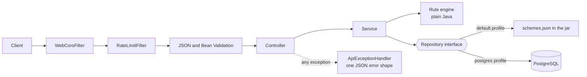
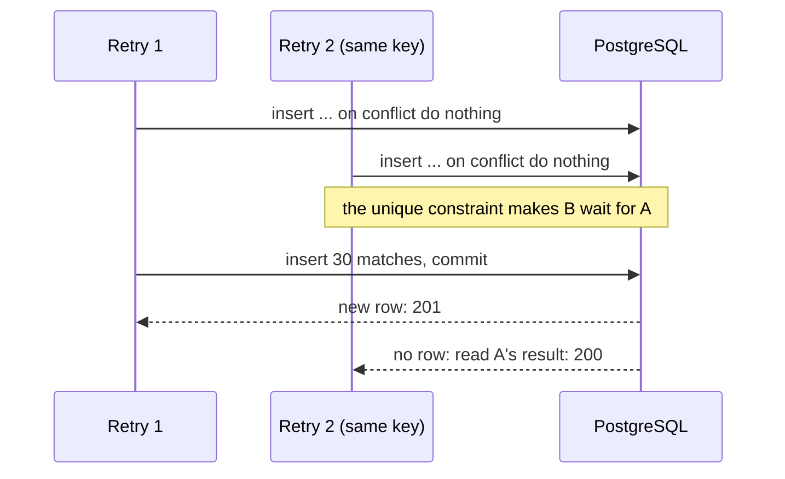
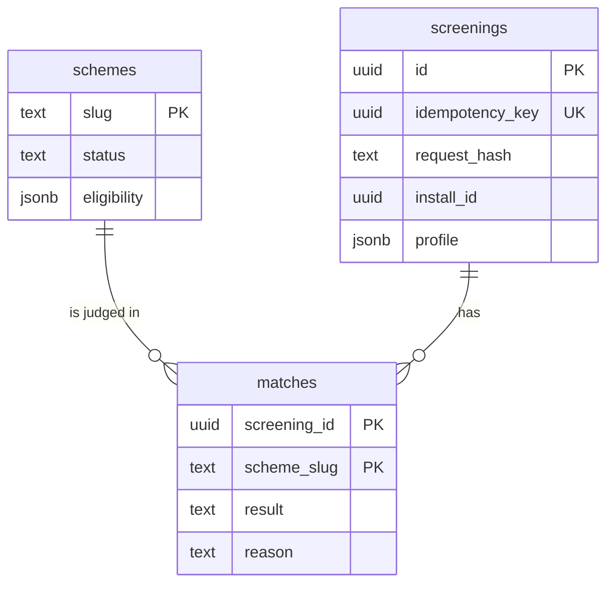

# SchemeMatch API in Spring Boot

A Java 17 / Spring Boot 4.1.2 rebuild of the SchemeMatch API. It takes a few answers about a person
and says which of 30 government schemes they likely qualify for, with reasons.

It is a second implementation, **not the live one**. The deployed API is `apps/api` (Fastify).
Spring Boot 4.1.2 is used because this repo installs no package younger than 14 days.

## How a request flows

## Saving exactly once

## Tables (this module's local database only)

## Run

| What | Command (in this folder) |
| --- | --- |
| All tests (needs Docker) | `./mvnw verify` |
| Tests without Docker | `./mvnw test` |
| API without a database | `./mvnw spring-boot:run` |
| API with PostgreSQL | `docker compose up --build` |

The API listens on port 3002.

## Routes

| Route | Answers |
| --- | --- |
| `GET /health` | 200 |
| `GET /schemes?state=WB` | 200, 400 |
| `POST /eligibility` | 200, 400, 413, 415 |
| `POST /screenings` with `Idempotency-Key` | 201 new, 200 retry, 400, 409, 413, 415, 503 |
| `DELETE /screenings` with `X-Install-Id` | 200, 400, 503 |
| `GET /cron/keepalive` with a secret | 200, 401 |

Any route can also answer 404, 429 or 500, as `{"error":{"code","message","details"?}}`.

## Differences from the Fastify API

- An explicit `null` answer counts as "not answered" (Fastify: 400).
- `38.0` is refused as an age. Validation messages differ; the field paths are the same kind.
- Wrong JSON, a too large body and a wrong content type keep their status but use other codes.
- A type error or unknown key is reported alone, before the range checks run.
- Every request counts toward the rate limit, except preflights. Schemes are not cached.

## Limits

Rate-limit counts live in one process. Flyway manages only this local schema, never Supabase.
See [LEARN.md](LEARN.md) ([Hinglish](LEARN.hi.md)) and [RESUME-FACTS.md](RESUME-FACTS.md).
