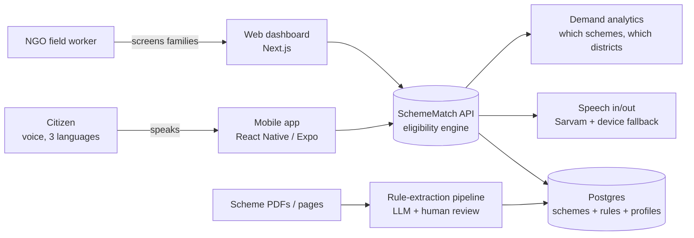

# SchemeMatch — documents (read these before any code)

**One line:** SchemeMatch turns India's 4,000+ government schemes into a 2-minute voice conversation, so a citizen learns exactly what they are entitled to, which documents they need, and where to apply.

## Reading order

| # | File | What it answers | Time |
|---|---|---|---|
| 1 | [PRD.md](PRD.md) | Who it is for, what problem, what we build (v1/v2), how we measure success, which JD asks it covers | 20 min |
| 2 | [ARCHITECTURE.md](ARCHITECTURE.md) | How it works inside: diagrams of every part, data model, APIs, security, testing, free-tier deploy | 30 min |
| 3 | [DESIGN.md](DESIGN.md) | How it looks and feels: your taste, tokens, 3D, motion, the Kaggle/Veo asset pipeline, every screen | 15 min |
| 4 | [BUILD-PLAN.md](BUILD-PLAN.md) | Week-by-week build order, daily commit rule, what you learn each week | 10 min |
| 5 | [CLAUDE-CODE-PLAYBOOK.md](CLAUDE-CODE-PLAYBOOK.md) | How a pro uses Claude Code on this project, which MCPs, and how YOU check the AI's work | 20 min |

`../CLAUDE.md` is the project instruction file Claude Code reads every session.

## The project on one page

## Why this project (interview answer, 30 seconds)
"Welfare schemes exist, but the people who need them can't read 40-page English PDFs. I built SchemeMatch: you answer four questions by voice in your own language and it tells you every scheme you qualify for, with the reason, the documents and where to apply. Field workers use the web dashboard to screen families offline. The hard parts were turning scheme rules into testable logic with measured accuracy, and making it work on cheap phones with bad internet."
