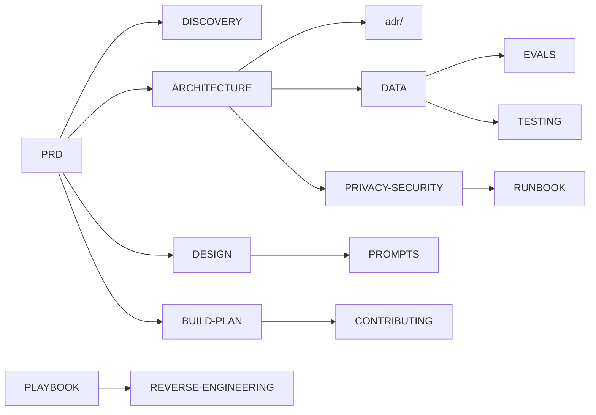
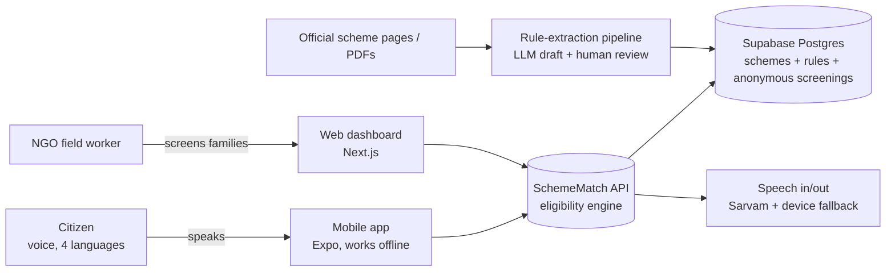

# SchemeMatch — documents (read these before any code)

**One line:** SchemeMatch turns India's government schemes into a 2-minute voice conversation, so a citizen learns what they are likely entitled to, which documents they need, and where to apply.

**New here, or lost? Start with [STORY.md](STORY.md):** the whole project as one simple story with pictures, from the problem to what's built and what's next. It's updated after every step. For the detailed *how* of each step, see [PROGRESS.md](PROGRESS.md), the build log.

## Reading order

| # | File | What it answers | Time |
|---|---|---|---|
| 1 | [PRD.md](PRD.md) | Who it is for, the problem, v1/v2 scope, target metrics, JD coverage | 20 min |
| 2 | [DISCOVERY.md](DISCOVERY.md) | Who we talk to, interview guide, what we learned | 10 min |
| 3 | [ARCHITECTURE.md](ARCHITECTURE.md) | How it works inside — diagrams of every part, data model, API | 25 min |
| 4 | [adr/](adr/README.md) | Why each big technical choice was made (7 one-page decisions) | 15 min |
| 5 | [DATA.md](DATA.md) | Where scheme data comes from, the rule format, three-valued logic | 20 min |
| 6 | [EVALS.md](EVALS.md) | How the AI rule extraction is measured honestly | 10 min |
| 7 | [TESTING.md](TESTING.md) | Test layers, the 120 profiles, merge gates | 10 min |
| 8 | [PRIVACY-SECURITY.md](PRIVACY-SECURITY.md) | Data inventory, DPDP, consent, threat model | 10 min |
| 9 | [DESIGN.md](DESIGN.md) + [design-refs/PROMPTS.md](design-refs/PROMPTS.md) | Look and feel, tokens, asset pipeline, prompt list | 15 min |
| 10 | [BUILD-PLAN.md](BUILD-PLAN.md) | 6-week plan, commit-sized tasks, what you learn each week | 10 min |
| 11 | [RUNBOOK.md](RUNBOOK.md) | Environments, free-tier limits, deploy/rollback, incidents | 10 min |
| 12 | [CLAUDE-CODE-PLAYBOOK.md](CLAUDE-CODE-PLAYBOOK.md) | How the agent is used and how you verify its work | 15 min |
| 13 | [REVERSE-ENGINEERING.md](REVERSE-ENGINEERING.md) | REA scope and workflow | 5 min |

Also: [`../CONTRIBUTING.md`](../CONTRIBUTING.md) (commits, PRs, definition of done). The agent's working rules live in a local `CLAUDE.md` that is deliberately not committed.

## How the docs connect

## The project on one page

## Why this project (interview answer, 30 seconds)
"Welfare schemes exist, but the people who need them can't read 40-page English PDFs. I built SchemeMatch: you answer a few questions by voice in your own language and it tells you which schemes you're likely eligible for, with the reason, the documents and where to apply. The hard parts were turning scheme rules into testable logic with measured extraction accuracy, and making it work offline on cheap phones."

*Status: docs only, as of 2026-10-18. Every metric in these docs is a target until a test or report in the repo proves it.*
