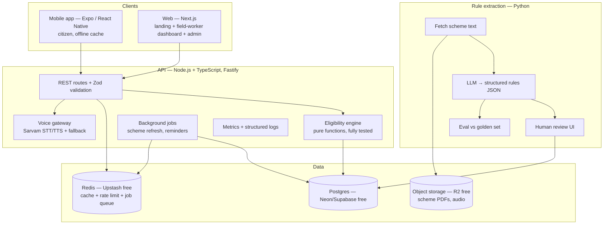
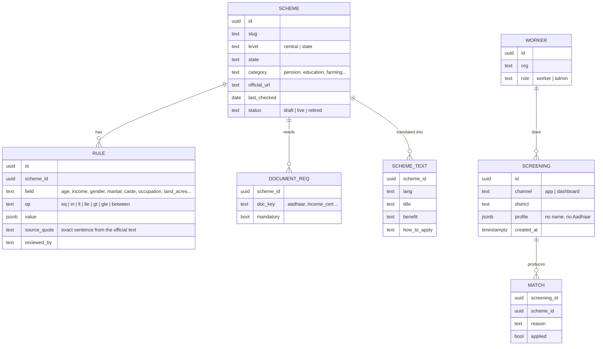
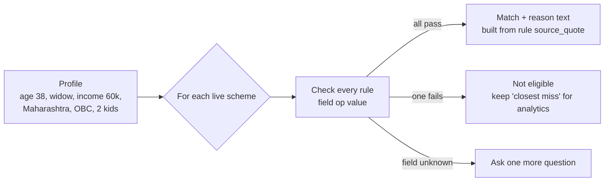
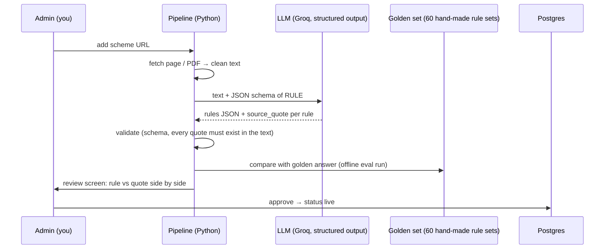
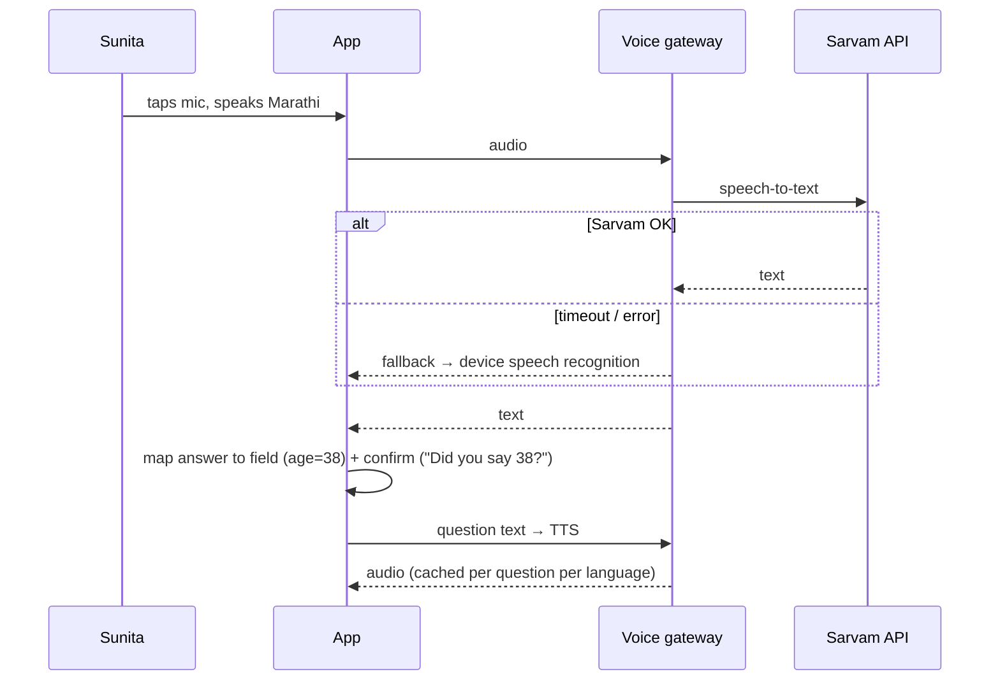
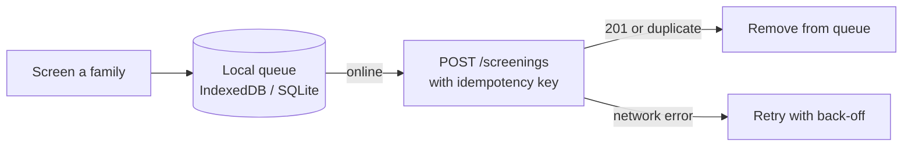
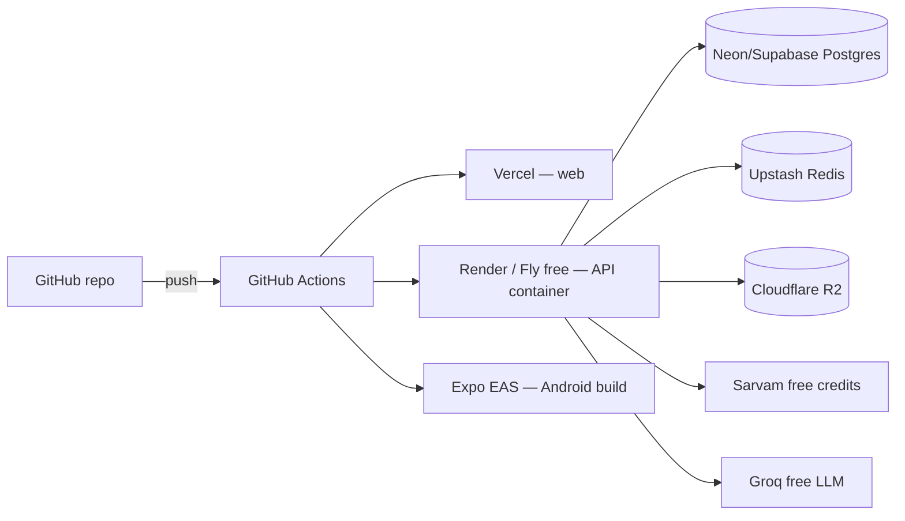

# ARCHITECTURE — SchemeMatch
*How it works inside. Every part has a diagram.*

## 1. System overview



**Why these choices (short ADRs):**
- **Fastify + TypeScript** for the API: same language as web and mobile, fast, schema-first. (Python is used only for the pipeline, where ML libraries live.)
- **Postgres** because rules, schemes and analytics are relational and need joins and GROUP BY.
- **Eligibility engine = pure functions** (input profile → output matches). No database inside, so it is easy to unit test 120 profiles.
- **Redis** for caching scheme lists, rate limiting, and a simple job queue (BullMQ).
- Everything fits **free tiers** (section 10).

## 2. Data model



Privacy rule baked into the schema: **no name, phone or Aadhaar is ever stored** in `SCREENING`.

## 3. Eligibility engine



- Rules are **AND** inside a group, groups can be **OR** (e.g. "widow OR divorced").
- Unknown field → the app asks only the questions that would change the result ("adaptive questions"). This keeps the conversation to ~4 questions.
- Output always carries the **reason** and the **official source link**.
- Tested with **120 profiles** whose expected results were written by hand.

## 4. Rule-extraction pipeline (the AI part) + evaluation



**Evaluation (what interviewers will ask about):**
- Metrics: rule-level precision / recall / F1, and "scheme fully correct %".
- **Quote check:** a rule whose `source_quote` is not found in the source text is rejected automatically (stops made-up rules).
- **Error taxonomy:** wrong operator, wrong number, missed rule, invented rule, wrong field. Counted and published.
- Compare 2 models (e.g. a large and a small open model) on accuracy, cost per scheme, latency — a real experiment table for the README.

## 5. Voice flow (reuses the Krishi Mitr pattern)



Audio for fixed questions is generated once and cached (saves free credits).

## 6. Offline sync (field-worker dashboard + app)



The **idempotency key** (a UUID made on the device) means a retry never creates a duplicate screening — the same "exactly once" idea from your internship XP fix.

## 7. API (v1)

| Method | Path | Purpose |
|---|---|---|
| GET | `/schemes?state=&lang=` | Catalog (cached) |
| POST | `/eligibility` | Profile → matches + next question |
| POST | `/screenings` | Save a screening (idempotent) |
| PATCH | `/matches/:id` | Mark applied |
| GET | `/analytics/demand?district=` | Funnel + top schemes |
| POST | `/voice/stt`, `/voice/tts` | Voice gateway |
| Admin | `/admin/schemes`, `/admin/rules/review` | Add scheme, review extracted rules |

All inputs validated with **Zod**; errors return clear 400s; rate-limited per IP with Redis.

## 8. Security & privacy
- DPDP-style minimisation: no name/phone/Aadhaar; district-level analytics only.
- Auth only for workers/admins (Supabase Auth or Auth.js); citizens never need to log in.
- Row-level security: a worker sees only their organisation's screenings.
- Secrets only in environment variables; never in code or chat.

## 9. Quality: tests, observability, performance

| Layer | Tool | What |
|---|---|---|
| Engine | Vitest | 120 profile tests, property tests for operators |
| API | Vitest + Supertest | every route, validation errors, idempotency |
| Mobile | Jest + React Native Testing Library | screens, offline state |
| Web | Playwright | screening flow, offline, language switch |
| Pipeline | pytest | quote check, schema validation, eval script |
| Load | k6 | p50/p95/p99 at 10/50/100 req/s → table in README |
| Observability | pino logs + /metrics (Prometheus format) + Grafana Cloud free | latency, error rate, voice fallback rate |
| CI | GitHub Actions | lint, typecheck, tests on every push |

## 10. Free-tier deployment



## 11. Repo layout (monorepo)

```
SchemeMatch/
├─ apps/
│  ├─ mobile/      Expo app (citizen)
│  ├─ web/         Next.js (landing, dashboard, admin)
│  └─ api/         Fastify API
├─ packages/
│  ├─ engine/      eligibility engine (pure TS, shared by api + offline app)
│  └─ i18n/        translations
├─ pipeline/       Python rule extraction + eval
├─ docs/           these documents
└─ CLAUDE.md
```

Sharing `packages/engine` means the app can check eligibility **offline** with the exact same code the server uses.
