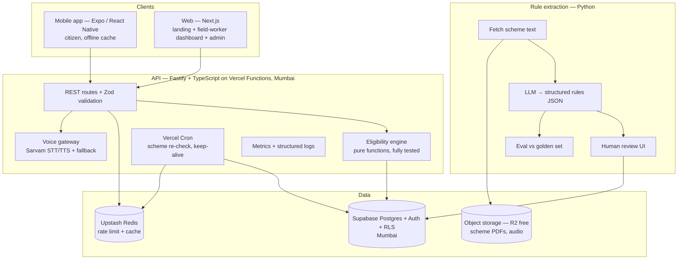
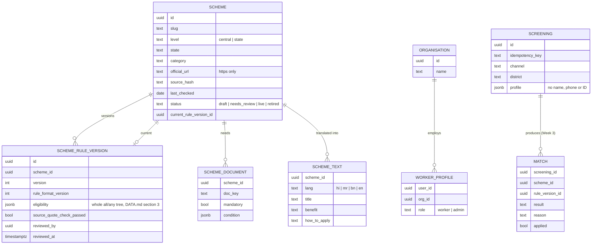
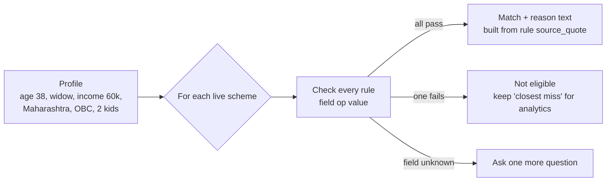
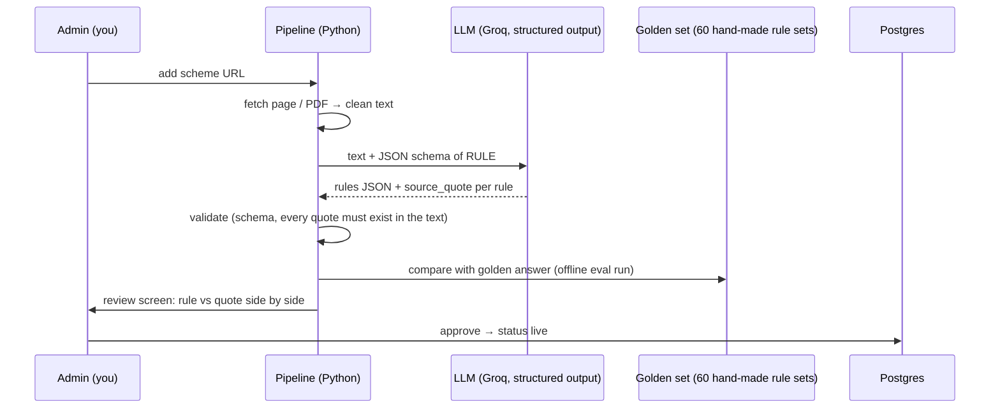
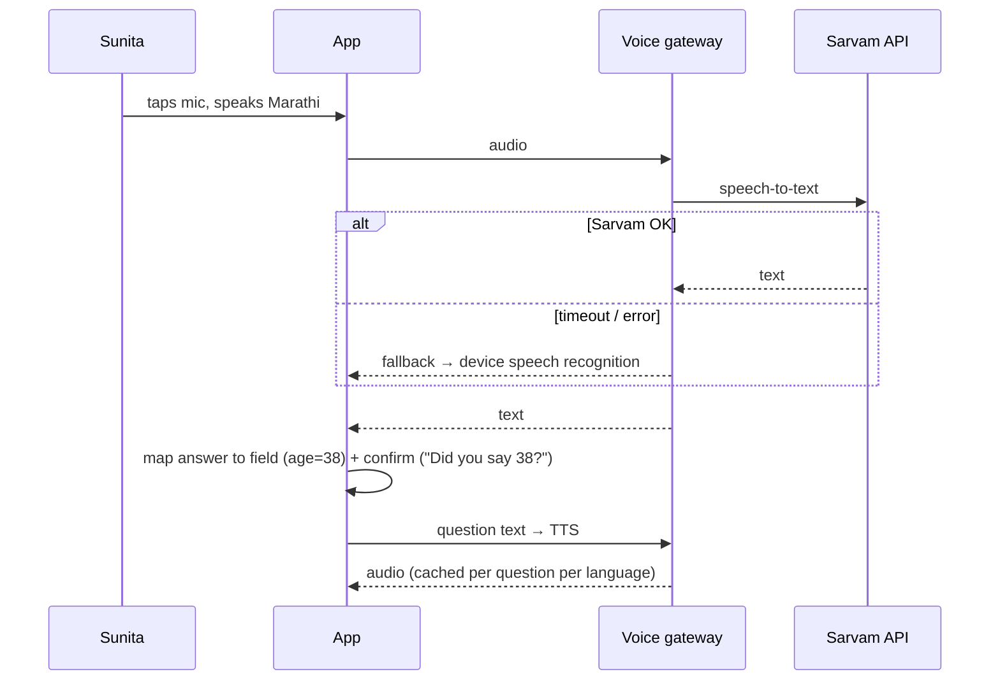
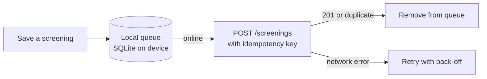
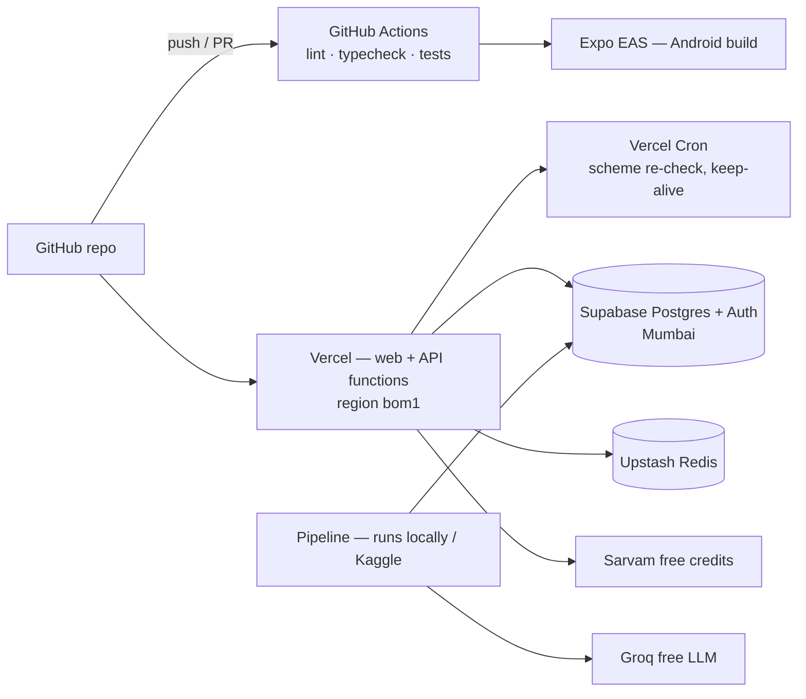

# ARCHITECTURE — SchemeMatch
*How it works inside. Every part has a diagram. The **why** behind each choice lives in [adr/](adr/README.md); the rule format in [DATA.md](DATA.md).*

## 1. System overview



**Why these choices:** see the ADRs — monorepo ([0001](adr/0001-monorepo-typescript-python.md)), Supabase ([0002](adr/0002-supabase-postgres.md)), pure engine ([0003](adr/0003-pure-engine-rule-dsl.md)), Vercel Functions instead of Render/Fly ([0004](adr/0004-api-hosting-vercel-functions.md)), Groq ([0005](adr/0005-llm-groq-structured-output.md)), Sarvam + fallback ([0006](adr/0006-voice-sarvam-with-device-fallback.md)), offline only in the app ([0007](adr/0007-offline-strategy.md)).

## 2. Data model



**Why rules are one `jsonb` tree per version, not one row per condition:** eligibility nests (`all` containing `any`), and a flat table can't hold "A AND (B OR C)" without parent pointers. Storing the whole tree per version keeps old versions, so any past screening can still be explained. `SCREENING`/`MATCH` arrive in Week 3 with `POST /screenings`. The live migration is in `supabase/migrations/`.

Privacy rule baked into the schema: **no name, phone or Aadhaar is ever stored** in `SCREENING`.

## 3. Eligibility engine



- Rules are a tree of `all` (AND) / `any` (OR) groups with three-valued logic (PASS / FAIL / UNKNOWN) — exact semantics in [DATA.md](DATA.md) §3.
- Unknown field → the app asks only the questions that would change the result ("adaptive questions"). This keeps the conversation to ~4 questions.
- Output always carries the **reason** and the **official source link**.
- Tested with **120 profiles** whose expected results were written by hand.

## 4. Rule-extraction pipeline (the AI part) + evaluation



**Evaluation (what interviewers will ask about):**
- Metrics: rule-level precision / recall / F1, and "scheme fully correct %".
- **Quote check:** a rule whose `source_quote` is not found in the source text is rejected automatically (stops made-up rules).
- **Error taxonomy:** wrong operator, wrong number, missed rule, invented rule, wrong field. Counted and published.
- Compare 2 models (e.g. a large and a small open model) on accuracy, cost per scheme, latency — a real experiment table for the README.

## 5. Voice flow (reuses the Krishi Mitr pattern)



Audio for fixed questions is generated once and cached (saves free credits).

## 6. Offline sync (citizen app only in v1 — [ADR 0007](adr/0007-offline-strategy.md))



The **idempotency key** (a UUID made on the device) means a retry never creates a duplicate screening — the same "exactly once" idea from your internship XP fix.

## 7. API (v1)

| Method | Path | Purpose |
|---|---|---|
| GET | `/schemes?state=&lang=` | Catalog (cached) |
| POST | `/eligibility` | Profile → matches + next question |
| POST | `/screenings` | Save a screening (idempotent) |
| PATCH | `/matches/:id` | Mark applied |
| GET | `/analytics/demand?district=` | Funnel + top schemes |
| POST | `/voice/stt`, `/voice/tts` | Voice gateway |
| Admin | `/admin/schemes`, `/admin/rules/review` | Add scheme, review extracted rules |

All inputs validated with **Zod**; errors return clear 400s; rate-limited per IP and per install ID with Upstash Redis.

## 8. Security & privacy
- DPDP-style minimisation: no name/phone/Aadhaar; district-level analytics only.
- Auth only for workers/admins (Supabase Auth); citizens never need to log in.
- Row-level security: a worker sees only their organisation's screenings.
- Secrets only in environment variables; never in code or chat.
- Full data inventory and threat model: [PRIVACY-SECURITY.md](PRIVACY-SECURITY.md).

## 9. Quality: tests, observability, performance
Test layers, the 120 profiles and merge gates: [TESTING.md](TESTING.md). Eval of the AI pipeline: [EVALS.md](EVALS.md). Monitoring signals and free-tier limits: [RUNBOOK.md](RUNBOOK.md).

## 10. Free-tier deployment



## 11. Repo layout (monorepo)

```
SchemeMatch/
├─ apps/
│  ├─ mobile/      Expo app (citizen)
│  ├─ web/         Next.js (landing, dashboard, admin)
│  └─ api/         Fastify API
├─ packages/
│  ├─ engine/      eligibility engine (pure TS, shared by api + offline app)
│  └─ i18n/        translations
├─ supabase/       migrations + RLS policies
├─ pipeline/       Python rule extraction + eval
├─ docs/           these documents
└─ CLAUDE.md
```

Sharing `packages/engine` means the app can check eligibility **offline** with the exact same code the server uses.
