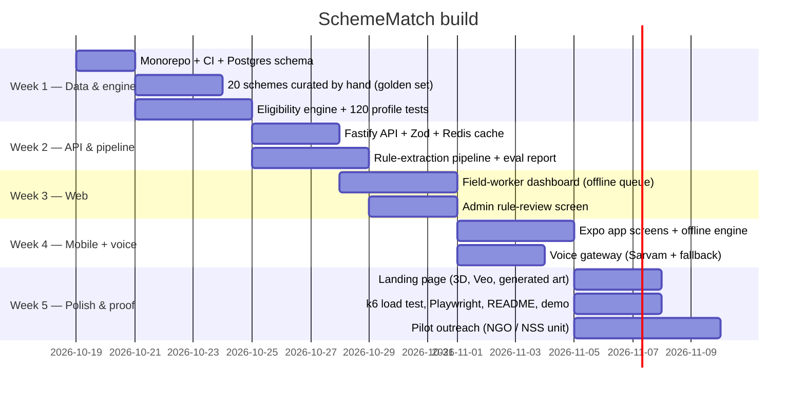

# BUILD PLAN — SchemeMatch (≈5 weeks at your hours)

## Golden rules
1. **Commit small, every study day** (a reviewer reads your commit history — it must show real, steady work).
2. **You explain before you merge:** for every change, you can say what it does and why, in English, in 1 minute.
3. **Tests first for the engine** — it is the heart; it must be 100% right.
4. Never claim users or numbers you didn't measure.

## What you learn each week (for interviews)

| Week | You must be able to explain |
|---|---|
| 1 | Schema design, foreign keys, why the engine is a pure function, unit testing |
| 2 | REST design, validation, caching, rate limiting; LLM structured output; precision/recall |
| 3 | Offline-first, idempotency keys, React state, forms |
| 4 | React Native vs React, Expo, device APIs, fallback design |
| 5 | Load testing (p95/p99), Lighthouse, deployment, observability |

## Definition of done for v1
- Live web demo + Android APK + 90-second video in README.
- README has: problem, architecture diagram, eval table (rule accuracy, 2 models compared), k6 latency table, test count, honest limitations.
- Every number on the resume is reproducible from the repo.

## Resume bullets this should produce (draft — real numbers only after measuring)
- Built a voice-first eligibility platform across **60 schemes** in **4 languages** for web and Android from one TypeScript codebase.
- Measured LLM rule extraction at **X% F1** on a hand-labelled golden set, blocking unsupported rules with source-quote verification.
- Served eligibility at **p95 Y ms** under **50 req/s** (k6), with idempotent offline sync for field workers.
