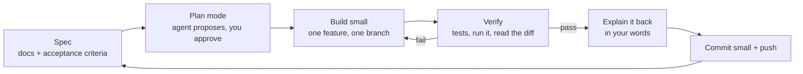
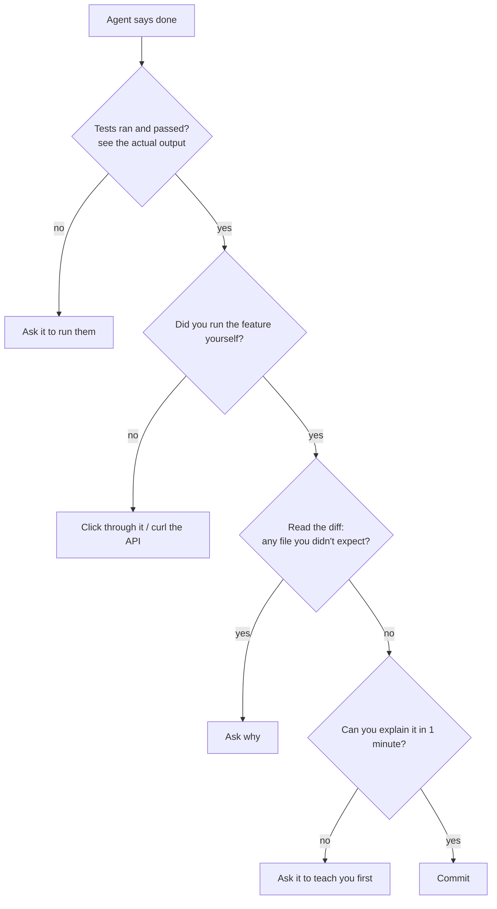

# CLAUDE CODE PLAYBOOK — how a pro builds SchemeMatch with an AI agent
*FDEs and AI-native engineers ship with coding agents. The skill is not typing prompts — it is **directing, constraining and verifying**.*

## 1. The pro loop

## 2. Rules the agent follows (in a local `CLAUDE.md`, not committed)
Read `docs/` first · never invent features outside the PRD · one feature per session · small commits, no Claude attribution lines · tests with every engine/API change, real output shown · never print or commit secrets · teach each change (English + one Hinglish line for hard parts).

## 3. Writing a good prompt (the 6 parts)

| Part | Example |
|---|---|
| Goal | "Add POST /screenings" |
| Context | "Schema in ARCHITECTURE §2; idempotency in §6; DATA.md §6 privacy" |
| Constraints | "Zod validation, no personal data stored, Supabase pooler" |
| Acceptance | "Duplicate key returns the existing row; 3 tests pass" |
| Verify | "Run `pnpm test --filter api` and show output" |
| Output | "Explain the change in 5 lines + 2 check questions" |

## 4. Claude Code features — when to use which

| Feature | Use it for on this project | Set up when |
|---|---|---|
| **Plan mode** | Anything touching > 2 files; read the plan, push back, then approve | Now |
| **CLAUDE.md** | Permanent rules, kept locally (git-ignored) | Done |
| **Subagents** | Read-only research in parallel ("how does Expo SQLite handle migrations?") so the main context stays clean | When needed |
| **Skills** | Repeatable workflows: `add-scheme` (source → hash → draft → review checklist), `run-eval` (pipeline + report), `release-check` (APK audit with REA) | W2–W3, once the steps are real |
| **Hooks** | After every edit: `pnpm typecheck` on changed package; before commit: gitleaks. Configured in `.claude/settings.json` | W1, after scaffold |
| **/code-review** | Before every merge to `main` | W1 |
| **Worktrees** | Risky experiments (e.g. trying a second LLM prompt) on a separate copy | When needed |
| **Separate sessions** | Parallel independent work (e.g. label schemes while the API is built) | When needed |

## 5. MCPs and agent tools

| Tool | Type | Why | Status |
|---|---|---|---|
| **GitHub** | MCP | Repo, issues, PRs | Connected |
| **context7** | MCP | Current docs for Expo, Next.js, Fastify, Zod, Supabase — used before writing library code | Connected |
| **Vercel** | MCP | Deploys, logs, env vars, docs | Connected |
| **Supabase** | MCP | Migrations, SQL, advisors (security/performance lints), type generation | Connected |
| **Stitch** | MCP | Quick screen mock-ups from DESIGN.md | Connected |
| **REA** | MCP (`rea`) | Reverse engineering — our APK/bundle audits, public-site observation ([REVERSE-ENGINEERING.md](REVERSE-ENGINEERING.md)) | Installed 2026-10-18 |
| **Agent-Reach** | CLI + skill | Research: web pages (Jina Reader), YouTube subtitles, RSS, GitHub. Zero-config channels only; Exa search needs a free key (free shared limit hit) | Installed 2026-10-18 |
| **Browser (built-in)** | Built-in | Check pages, screenshots, flows | Available |
| **iOS simulator** | Built-in | Optional; Android via Expo Go / emulator is the real target | Available |

Agent-Reach accounts rule: cookie-based platforms (Reddit, X, LinkedIn…) only with a **secondary account**, never your main ones, and only after you agree.

## 6. How YOU check the agent's work (never trust "done")

**Red flags:** numbers with no command that produced them · "should work" without running · tests edited in the same commit to pass · new dependencies you didn't ask for · huge diffs for a small ask · a library API that context7 can't confirm (possible hallucination).

## 7. Reverse engineering
Trigger: "reverse engineer X" → REA, outside-in, evidence-first, only on targets you own or are authorised to examine. Full scope table and workflow: [REVERSE-ENGINEERING.md](REVERSE-ENGINEERING.md).
