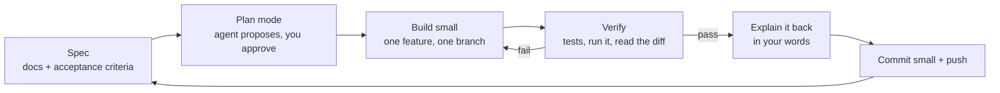
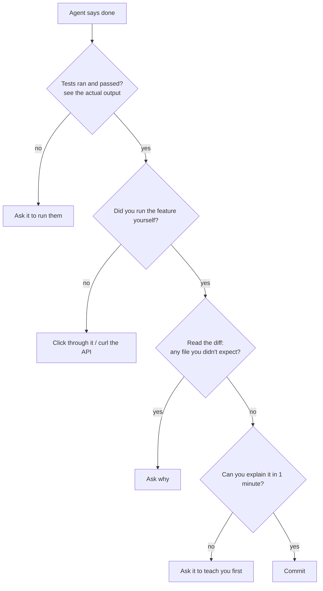

# CLAUDE CODE PLAYBOOK — how a pro builds SchemeMatch with an AI agent
*FDE interns and AI-native engineers ship with coding agents. The skill is not typing prompts — it is directing, constraining and verifying.*

## 1. The pro loop

## 2. Rules you give the agent (already in `../CLAUDE.md`)
1. Read `docs/` before coding; never invent features not in the PRD.
2. One feature per session; small commits with clear messages.
3. Tests with every change to the engine/API; run them before saying "done".
4. Never print or commit secrets.
5. Explain each change simply (English + one Hinglish line for hard parts) so you learn it.

## 3. Writing a good prompt (the 6 parts)

| Part | Example |
|---|---|
| Goal | "Add POST /screenings" |
| Context | "Schema in ARCHITECTURE.md §2; idempotency in §6" |
| Constraints | "Zod validation, no personal data stored" |
| Acceptance | "Duplicate key returns the existing row; 3 tests pass" |
| Verify | "Run `pnpm test` and show output" |
| Output | "Explain the change in 5 lines" |

## 4. Pro features to use

| Feature | Use it for |
|---|---|
| **Plan mode** | Any change touching more than 2 files — read the plan before approving |
| **CLAUDE.md** | Permanent project rules (done) |
| **Subagents** | Parallel research (e.g. "find how Expo handles offline storage") without bloating context |
| **Skills** | Repeatable workflows (e.g. "add a scheme", "run eval") — create once, reuse |
| **Hooks** | Auto-run lint/typecheck after edits so broken code never sits |
| **/code-review** | Before every merge to `main` |
| **Worktrees** | Try a risky idea on a separate copy |

## 5. MCPs (tools the agent can use)

| MCP | Why | Status |
|---|---|---|
| **GitHub** | Issues, PRs, open-source contributions | Connected |
| **context7** | Up-to-date docs for Expo, Next.js, Fastify, Zod | Connected |
| **Vercel** | Deploy web, read build/runtime logs | Connected |
| **Supabase** | Postgres + auth management | Needs your authorisation (`/mcp` in a terminal session) |
| **Browser (built-in)** | Verify pages, screenshots | Available |
| **iOS/Android simulator** | See the mobile app | iOS simulator available; Android via Expo Go on your phone |
| **Stitch** | Quick UI mock-ups | Connected |
| Reverse-engineering + your repos | **Pending — you will send the links** | To add |

## 6. How YOU check the agent's work (never trust "done")

Red flags: numbers with no command that produced them · "should work" without running · tests edited to pass · new dependencies you didn't ask for · huge diffs for a small ask.

## 7. Reverse engineering (to be added)
You will provide the reverse-engineering repo and other repos. They get installed and wired in here, with a rule: when you say **"reverse engineer X"**, the agent uses that tooling to study a product's behaviour from the outside (network calls, UI flows, public docs) — never by copying private source code, and within the product's terms.
