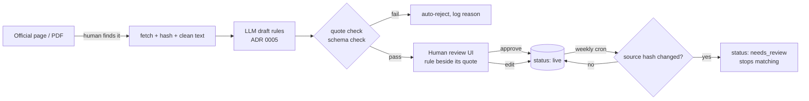
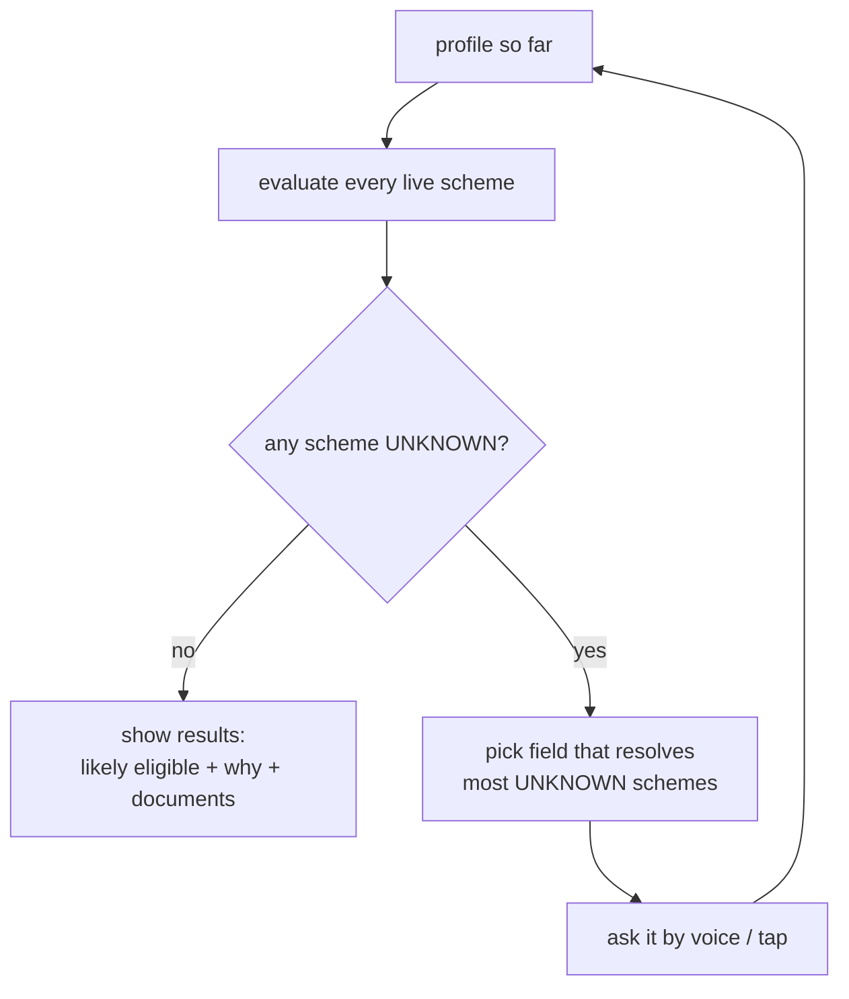

# DATA — where scheme data comes from, and the rule format
*The engine is only as right as its data. This doc is the contract between the pipeline (Python), the engine (TS) and the reviewer (you).*

## 1. Sourcing — legally and honestly

| Source | Use it for | Rule |
|---|---|---|
| Ministry / department scheme page or guidelines PDF | **Primary source** for every rule | Store URL, retrieved date and a SHA-256 of the file in `pipeline/sources/` |
| Gazette notifications | Amendments (income limits, age bands change) | Link from the scheme's `amendments` list |
| myScheme.gov.in | **Discovery and linking only** | Its Terms of Use forbid bots/scrapers without authorisation → read it like a human, never scrape; link to it with the URL unmodified, never frame it |
| State portals (Maharashtra, West Bengal) | State schemes | Same as ministry pages |

- Every scheme carries `official_url`, `source_hash`, `last_checked`, and a **"not an official government app"** line in the UI.
- If a source disappears or changes hash, the scheme flips to `needs_review` and stops matching until re-approved (RUNBOOK §scheme refresh).
- Treat scraped/fetched text as untrusted input to the LLM (prompt injection is possible even in PDFs) — see PRIVACY-SECURITY §threats.



## 2. Scheme record

```json
{
  "slug": "mh-sanjay-gandhi-niradhar",
  "level": "state",
  "state": "MH",
  "category": "pension",
  "official_url": "https://…",
  "source_hash": "sha256:…",
  "last_checked": "2026-10-20",
  "status": "live",
  "rule_format_version": 1,
  "eligibility": { "...": "see §3" },
  "documents": [
    { "key": "aadhaar", "mandatory": true },
    { "key": "income_certificate", "mandatory": true },
    { "key": "husband_death_certificate", "mandatory": true, "when": { "field": "marital_status", "op": "eq", "value": "widow" } }
  ],
  "text": { "mr": { "title": "…", "benefit": "…", "how_to_apply": "…" }, "hi": {}, "bn": {}, "en": {} }
}
```

## 3. Rule format v1

A scheme's `eligibility` is a tree of **groups** (`all` = AND, `any` = OR) whose leaves are **conditions**.

```json
{
  "all": [
    { "field": "state", "op": "eq", "value": "MH", "source_quote": "resident of Maharashtra" },
    { "field": "age", "op": "gte", "value": 18, "source_quote": "aged 18 years and above" },
    { "field": "annual_family_income", "op": "lte", "value": 21000, "source_quote": "annual family income not exceeding Rs. 21,000" },
    { "any": [
        { "field": "marital_status", "op": "in", "value": ["widow", "divorced", "abandoned"], "source_quote": "widows, divorced or deserted women" },
        { "field": "disability_percent", "op": "gte", "value": 40, "source_quote": "persons with 40% or more disability" }
    ]}
  ]
}
```
*(Example values are illustrative until checked against the real source.)*

**Fields (v1 profile)** — all optional, all coarse, none identifying:
`state, district, age, gender, marital_status, annual_family_income, caste_category (SC/ST/OBC/General/EWS), occupation, land_acres, disability_percent, is_student, education_level, household_size, has_bpl_card, children_count, is_pregnant_or_lactating`.

**Operators:** `eq, neq, in, not_in, lt, lte, gt, gte, between` (inclusive).

**Three-valued logic** — each condition returns `PASS`, `FAIL` or `UNKNOWN` (field not answered):

| Group | Result |
|---|---|
| `all` | any FAIL → FAIL · else any UNKNOWN → UNKNOWN · else PASS |
| `any` | any PASS → PASS · else any UNKNOWN → UNKNOWN · else FAIL |

- Scheme result: PASS → **likely eligible**; FAIL → not eligible (keep the failing condition as the "closest miss"); UNKNOWN → **ask the next question**.
- **Next question** = the unknown field that appears in the most still-UNKNOWN schemes (ties → fixed priority list). This is how we keep the conversation to ~4–6 questions.
- **Reason text** is generated from the PASS conditions' `source_quote` + translated field labels — never free-written by an LLM at runtime.



### Criteria we can't model, and unclear text
- `unmodelled`: criteria with no matching profile field (e.g. "not an income-tax payer", "has a savings account"). Each one is still quoted. The app shows them as **"you must also confirm…"** instead of guessing.
- `ambiguous`: notes where the source is unclear or conflicts with another official source (e.g. Maharashtra's page says old-age pension from 65; the national rule says 60). These are excluded from accuracy numbers.
- Residency for state schemes comes from the scheme's `state` field, not from a rule condition.

## 4. Versioning and change
- `rule_format_version` on every scheme; the engine refuses unknown versions (fails closed → scheme hidden, error logged).
- Rule edits are rows with `created_by`, `reviewed_by`, `reviewed_at`; old versions kept so a past screening can be explained.
- The app's offline snapshot has a `snapshot_version`; the API tells the app when a newer one exists.

## 5. v1 catalog target
**30 schemes**: ~12 central, ~10 Maharashtra, ~8 West Bengal, chosen for coverage of the personas (pension, widow, farmer, student, health, housing, ration). Target, not a promise — the list lives in `pipeline/catalog.csv` with a `why_chosen` column.

## 6. What we never store
Name, phone, Aadhaar/any ID number, exact address, audio, free-text answers. Profiles are coarse buckets (age in years, income as a number, district) and are saved only if the user taps **Save**. Full inventory in PRIVACY-SECURITY.md.
