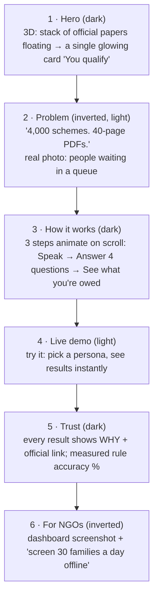
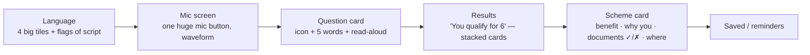
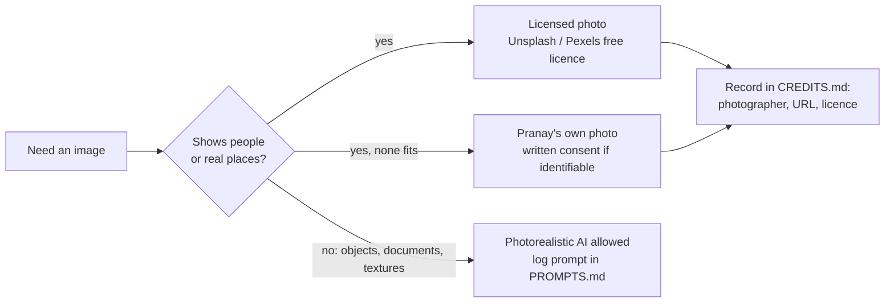

# DESIGN — SchemeMatch
*How it looks and feels. Based on your taste from the portfolio and FollowUp.*

## 1. Your taste (what we keep)
- **3D objects and depth**, scroll-driven motion, scenes that feel premium — not flat templates.
- **Inverted sections**: dark ↔ light flips between sections for rhythm and contrast.
- **Real photography, not illustration.** SchemeMatch is about a real problem, so people in the imagery are real people in real places (licensed photos, [design-refs/CREDITS.md](design-refs/CREDITS.md)). No anime, no illustrated people, no AI-generated people. Generated visuals are only for non-person things (documents, stamps, textures, 3D objects).
- FollowUp's discipline: real content, calm UI where people work, nothing decorative inside the task flow.

## 2. Two faces, two rules

| Surface | Who | Style |
|---|---|---|
| **Landing page (web)** | Recruiters, NGOs, visitors | Your full taste: 3D object hero, scroll story, inverted sections, licensed real photos, Veo only for object/paper motion |
| **Citizen app (mobile)** | Sunita on a ₹8,000 phone | Calm, big, fast. Simple SVG icons; at most one small photo per screen. **No 3D** (performance + clarity) |
| **Dashboard (web)** | Meena, admin | FollowUp-style: dense, clear tables, keyboard-friendly |

## 3. Landing page story (scroll)

### Locked photos (chosen 2026-10-18, credits in [design-refs/CREDITS.md](design-refs/CREDITS.md))
| Section | Photo | Note |
|---|---|---|
| 1 · Hero (dark) | #1 woman in her doorway | Portrait beside the 3D paper-to-card object; no caption about her |
| 2 · Problem (light) | #6 crowd waiting at a barrier | Sits under the "4,000 schemes" line |
| 3 · How it works | #7 hand holding a phone | Step 1, "Speak in your language" |
| Who it's for | #4 four women on a village road | Context only, never labelled as users |
| 6 · For NGOs (inverted) | #9 village below Kalsubai hill | Wide background behind the dashboard screenshot |

All five get one shared grade (warm, slightly desaturated, ink-blue shadows) so they read as one set.

## 4. Design tokens: citizen app (chosen 2026-10-27)
Picked by Pranay on the design canvas from 16 palettes (13 from his references, 3 extra): **04 "Better experiences"**. The earlier cream and marigold tokens were rejected.

| Token | Value | Use |
|---|---|---|
| `bg` | `#E9E8E6` stone grey | screen ground |
| `ink` / `deep` | `#2A2A2A` charcoal | text, primary buttons, the first result tile |
| `muted` | `#5A5A5A` | secondary text (5.6:1 on bg) |
| `accent` | `#E10600` signal red | progress, ticks, number circles: used sparingly |
| `accentText` | `#C40500` | red text on bg (5.1:1) |
| `line` / `tint` | `#CFCDC9` / `#D6D4D0` | hairlines, picture tiles |

- **Rule:** three colours (grey, charcoal, one red), lots of space, one picture per idea.
- **Type:** display = Playfair Display (italic for the one accent word); body = Inter; Bengali = Noto Serif Bengali (questions, headings) and Noto Sans Bengali (body). Bengali text never falls back to a Latin font and uses Bengali digits. All fonts ship inside the app (offline).
- **Pictures:** Kaggle SDXL object renders, "stone" set, grey studio light with a red accent. **Only where the picture shows what the text says**; otherwise a drawn SVG icon. Every image is checked at full zoom for fake text or emblems (PROMPTS.md).
- **Code:** `apps/mobile/src/ui/theme.ts` holds these values; contrast ratios are computed there.
- **Motion:** GSAP + ScrollTrigger on the landing only; respect `prefers-reduced-motion`.
- **3D:** React Three Fiber on the landing hero; lazy-loaded; a static image fallback on low-end devices.

## 5. Citizen app screens

Rules: 48 px+ tap targets, one action per screen, every text has a 🔊 button, icons from the generated art set (consistent style), no colour-only meaning.

## 6. Asset pipeline — real photos first

- **People and places:** real photos with a clear free licence (Unsplash License, Pexels License). Check every photo page (Unsplash+ is paid, not free), record photographer, URL and licence in [design-refs/CREDITS.md](design-refs/CREDITS.md). Never caption a stock person as a user or beneficiary.
- **Never** take photos of people from social media, Google Images or news sites (consent + copyright).
- **Own photos** (best for authenticity): taken during DISCOVERY visits, with written consent from identifiable people, or only hands, documents and places.
- **AI only for non-person scenes:** documents, stamps, textures, 3D object references → `gen.py` (fast concepts) or Kaggle T4 SDXL (HD). Prompts in [design-refs/PROMPTS.md](design-refs/PROMPTS.md). No AI-generated "real-looking" people, ever.
- **Video:** Veo 3.1 only for object/paper motion (papers lifting into one card), then `worldvid.sh` with a non-anime upscaler.
- **3D:** simple objects (papers, card, stamp) in React Three Fiber, or a CC0 glTF — check licences.
- **Treatment:** to keep stock photos from looking like stock, use one consistent grade across all of them (warm, slightly desaturated, ink-blue shadows) and crop tight.

## 7. Accessibility & India-specific checks
See also TESTING.md §5 (real-device checks).

Contrast AA in both themes · screen-reader labels in all 4 languages · test on a real low-end Android · test Devanagari and Bengali line height · numbers in Indian format (₹1,20,000).
