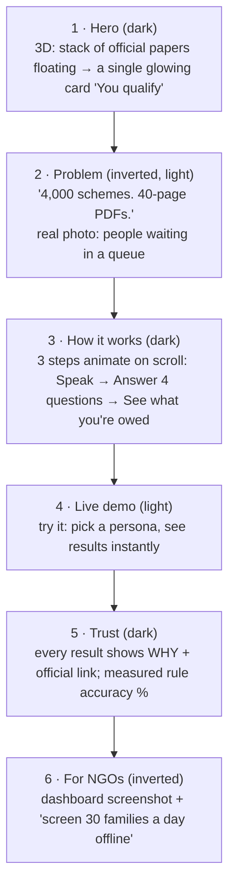
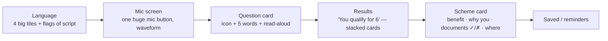
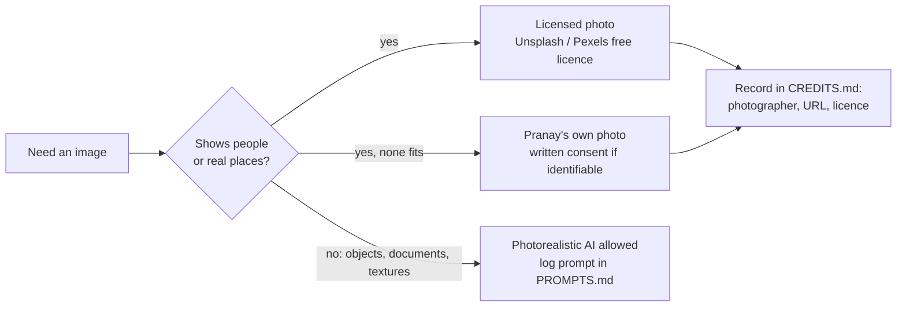

# DESIGN — SchemeMatch
*How it looks and feels. Based on your taste from the portfolio and FollowUp.*

## 1. Your taste (what we keep)
- **3D objects and depth**, scroll-driven motion, scenes that feel premium — not flat templates.
- **Inverted sections**: dark ↔ light flips between sections for rhythm and contrast.
- **Real photography, not illustration.** SchemeMatch is about a real problem, so people in the imagery are real people in real places (licensed photos, [design-refs/CREDITS.md](design-refs/CREDITS.md)). No anime, no illustrated people, no AI-generated people. Generated visuals are only for non-person things (documents, stamps, textures, 3D objects).
- FollowUp's discipline: real content, calm UI where people work, nothing decorative inside the task flow.

## 2. Two faces, two rules

| Surface | Who | Style |
|---|---|---|
| **Landing page (web)** | Recruiters, NGOs, visitors | Your full taste: 3D object hero, scroll story, inverted sections, licensed real photos, Veo only for object/paper motion |
| **Citizen app (mobile)** | Sunita on a ₹8,000 phone | Calm, big, fast. Simple SVG icons; at most one small photo per screen. **No 3D** (performance + clarity) |
| **Dashboard (web)** | Meena, admin | FollowUp-style: dense, clear tables, keyboard-friendly |

## 3. Landing page story (scroll)

## 4. Design tokens (starting point — tune in the build)

| Token | Dark | Light (inverted sections) | Use |
|---|---|---|---|
| `--bg` | `#0B0F14` deep ink | `#F4F1EA` paper | page ground |
| `--fg` | `#EDEAE3` | `#14181D` | text |
| `--accent` | `#F2A93B` marigold | `#C77A0A` | "you qualify", primary buttons (warm, Indian, not tech-blue) |
| `--ok` | `#3FB68B` | `#1E8A63` | eligible |
| `--muted` | `#8A93A0` | `#5D6672` | secondary text |

- **Type:** display = a characterful grotesk (e.g. "Clash Display" or "Space Grotesk" fallback) used sparingly; body = "Inter"-class sans; **Devanagari/Bengali** via Noto Sans Devanagari / Noto Sans Bengali — must be tested, not assumed.
- **Motion:** GSAP + ScrollTrigger on the landing only; respect `prefers-reduced-motion`.
- **3D:** React Three Fiber on the landing hero; lazy-loaded; a static image fallback on low-end devices.

## 5. Citizen app screens

Rules: 48 px+ tap targets, one action per screen, every text has a 🔊 button, icons from the generated art set (consistent style), no colour-only meaning.

## 6. Asset pipeline — real photos first

- **People and places:** real photos with a clear free licence (Unsplash License, Pexels License). Check every photo page (Unsplash+ is paid, not free), record photographer, URL and licence in [design-refs/CREDITS.md](design-refs/CREDITS.md). Never caption a stock person as a user or beneficiary.
- **Never** take photos of people from social media, Google Images or news sites (consent + copyright).
- **Own photos** (best for authenticity): taken during DISCOVERY visits, with written consent from identifiable people, or only hands, documents and places.
- **AI only for non-person scenes:** documents, stamps, textures, 3D object references → `gen.py` (fast concepts) or Kaggle T4 SDXL (HD). Prompts in [design-refs/PROMPTS.md](design-refs/PROMPTS.md). No AI-generated "real-looking" people, ever.
- **Video:** Veo 3.1 only for object/paper motion (papers lifting into one card), then `worldvid.sh` with a non-anime upscaler.
- **3D:** simple objects (papers, card, stamp) in React Three Fiber, or a CC0 glTF — check licences.
- **Treatment:** to keep stock photos from looking like stock, use one consistent grade across all of them (warm, slightly desaturated, ink-blue shadows) and crop tight.

## 7. Accessibility & India-specific checks
See also TESTING.md §5 (real-device checks).

Contrast AA in both themes · screen-reader labels in all 4 languages · test on a real low-end Android · test Devanagari and Bengali line height · numbers in Indian format (₹1,20,000).
