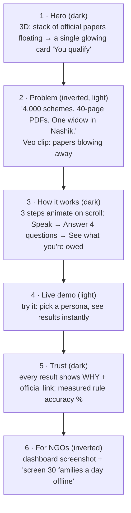
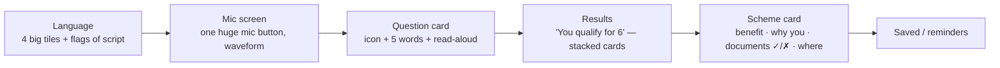

# DESIGN — SchemeMatch
*How it looks and feels. Based on your taste from the portfolio and FollowUp.*

## 1. Your taste (what we keep)
- **3D objects and depth**, scroll-driven motion, scenes that feel premium — not flat templates.
- **Inverted sections**: dark ↔ light flips between sections for rhythm and contrast.
- **Generated art per section** (made with your Kaggle + Veo pipeline, below), never stock icons or "AI-generic" gradients.
- FollowUp's discipline: real content, calm UI where people work, nothing decorative inside the task flow.

## 2. Two faces, two rules

| Surface | Who | Style |
|---|---|---|
| **Landing page (web)** | Recruiters, NGOs, visitors | Your full taste: 3D hero, scroll story, inverted sections, Veo video, generated art |
| **Citizen app (mobile)** | Sunita on a ₹8,000 phone | Calm, big, fast. Art only as small illustrations. **No 3D** (performance + clarity) |
| **Dashboard (web)** | Meena, admin | FollowUp-style: dense, clear tables, keyboard-friendly |

## 3. Landing page story (scroll)

## 4. Design tokens (starting point — tune in the build)

| Token | Dark | Light (inverted sections) | Use |
|---|---|---|---|
| `--bg` | `#0B0F14` deep ink | `#F4F1EA` paper | page ground |
| `--fg` | `#EDEAE3` | `#14181D` | text |
| `--accent` | `#F2A93B` marigold | `#C77A0A` | "you qualify", primary buttons (warm, Indian, not tech-blue) |
| `--ok` | `#3FB68B` | `#1E8A63` | eligible |
| `--muted` | `#8A93A0` | `#5D6672` | secondary text |

- **Type:** display = a characterful grotesk (e.g. "Clash Display" or "Space Grotesk" fallback) used sparingly; body = "Inter"-class sans; **Devanagari/Bengali** via Noto Sans Devanagari / Noto Sans Bengali — must be tested, not assumed.
- **Motion:** GSAP + ScrollTrigger on the landing only; respect `prefers-reduced-motion`.
- **3D:** React Three Fiber on the landing hero; lazy-loaded; a static image fallback on low-end devices.

## 5. Citizen app screens

Rules: 48 px+ tap targets, one action per screen, every text has a 🔊 button, icons from the generated art set (consistent style), no colour-only meaning.

## 6. Asset pipeline (your tools — reuse them)
- **Images:** Kaggle notebook on free T4 GPU — the portfolio pipeline (`~/Desktop/portfolio/tools/gen.py`, `batch.py`, `hd.sh`). Use an SDXL/Flux-class model for this project's non-anime, warm editorial style: paper textures, Indian village and city scenes, document objects.
- **Video:** Gemini Veo 3.1 for 2–3 short hero/problem clips (~5 per day per account), scroll-scrubbed with the portfolio's `worldvid.sh` approach.
- **3D:** simple modelled objects (papers, card, stamp) in React Three Fiber, or a free glTF from Poly Pizza / Sketchfab (check licence).
- Keep every prompt in `docs/design-refs/PROMPTS.md` so assets are reproducible.

**First rough references to generate (Day 1 of design):**
1. Hero: "floating stack of official Indian government forms dissolving into one glowing marigold card, dark ink background, cinematic depth of field".
2. Problem: "elderly Indian woman in a village doorway holding papers, warm morning light, editorial illustration".
3. Icon set: 12 flat-but-textured icons — pension, scholarship, ration, farm, health, house, documents, mic, location, check, cross, bell.

## 7. Accessibility & India-specific checks
Contrast AA in both themes · screen-reader labels in all 4 languages · test on a real low-end Android · test Devanagari and Bengali line height · numbers in Indian format (₹1,20,000).
