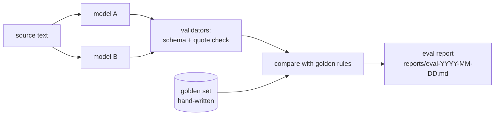

# EVALS — how we measure the AI part honestly
*The pipeline drafts rules with an LLM. This doc defines how we know how good those drafts are — and how we avoid fooling ourselves.*

## 1. What is evaluated
Only the **rule-extraction pipeline** (scheme text → rule JSON). The eligibility engine is not "evaluated"; it is **tested** (TESTING.md) because it is deterministic.



## 2. Golden set
- **Size:** 30 schemes (the v1 catalog) hand-labelled by you, plus a frozen **held-out 10** you label but never look at while tuning prompts.
- **Labelling guide** (`pipeline/golden/GUIDE.md`, written before labelling):
  - one condition per eligibility criterion stated in the text; nothing inferred that the text does not say;
  - numbers exactly as written (₹ amounts as integers, ages as years);
  - "and" → `all`, "or"/"either" → `any`; when the text is ambiguous, mark `ambiguous: true` with a note — these are excluded from accuracy and counted separately.
- Label each scheme **twice, a week apart**, and measure your own agreement. If you disagree with yourself on >10% of conditions, the guide is unclear — fix the guide first.
- Golden files are never put in prompts or few-shot examples (**leakage rule**). Few-shot examples come from 3 extra schemes outside the golden set.

## 3. Metrics
A predicted condition **matches** a golden one when `field`, `op` and `value` are equal (numbers exact, lists as sets) and it sits under the same group type.

| Metric | Meaning |
|---|---|
| Condition precision | matched / predicted — "how much of what it said is right" |
| Condition recall | matched / golden — "how much of the truth it found" |
| Condition F1 | harmonic mean of the two |
| Scheme exact-match % | schemes where every condition and the group structure are right — the number that matters for users |
| Quote-check reject rate | % of predicted conditions auto-rejected because `source_quote` is not in the text |
| Cost / scheme, latency / scheme | from the API's token counts and wall-clock time |

## 4. Validators (run before comparison, also in production)
1. **Schema:** output must validate against `rule.schema.json`.
2. **Quote check:** `source_quote` must appear in the cleaned source text (normalised whitespace/case; ≥ 0.9 fuzzy ratio allowed for line-break artefacts). Fail → condition rejected, counted as a false positive.
3. **Range sanity:** age 0–120, income ≥ 0, percentages 0–100.

## 5. Error taxonomy (every miss gets one label)
`wrong_field` · `wrong_operator` · `wrong_value` · `missed_condition` · `invented_condition` · `wrong_grouping` (AND/OR) · `ambiguous_source`. The report shows counts per label and 3 real examples of the top two — this is your interview story ("most errors were AND/OR grouping, so I changed X").

## 6. Experiment protocol
- Pin model IDs, prompt version (git hash) and temperature 0 in `pipeline/config.yaml`; each report records them.
- Run both models on the same 30; report per-model metrics + cost + latency in one table.
- Change one thing at a time (prompt, model, chunking) and keep every report — the history is the evidence.
- Final numbers are quoted from the **held-out 10**, not the set you tuned on.

## 7. Report template (`reports/eval-YYYY-MM-DD.md`)
```
Models: A=<id>, B=<id> · Prompt: <git hash> · Golden: 30 (+10 held-out)
| Model | P | R | F1 | Exact % | Quote rejects | ₹/scheme | s/scheme |
Top errors: <label: count, examples>
What I changed since last run / what I will try next
```

## 8. What we will *not* claim
No accuracy number without its report file and the command that produced it. "≥ 90%" in the PRD is a **target**.
