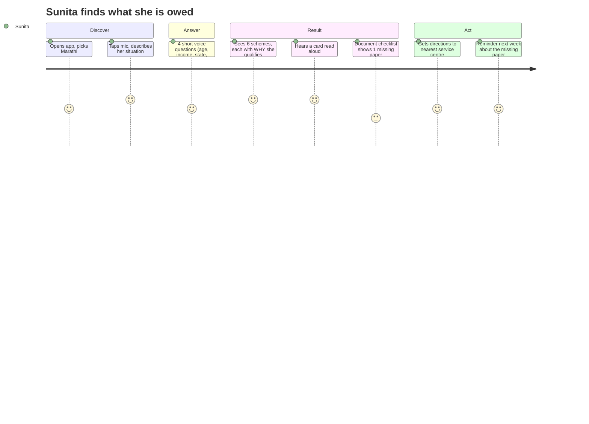
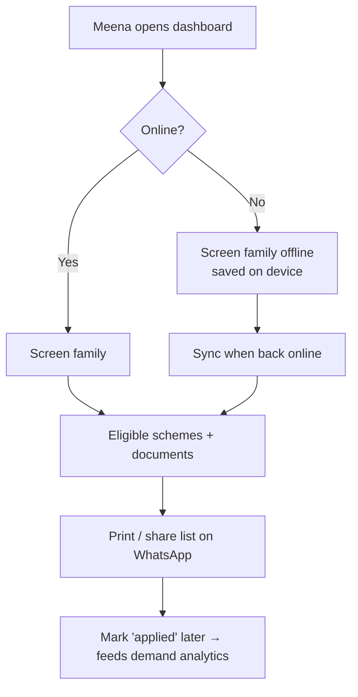

# PRD — SchemeMatch
*What we build and why. No code here.*

## 1. The problem
- myScheme (the government's own portal) lists **4,000+ central and state schemes**. Eligibility rules live in long documents, mostly English.
- The people who qualify most — widows, small farmers, daily-wage workers, students from poor families — are least able to read them. Haqdarshak (a funded social enterprise) exists only because this gap is real.
- Result: money that is meant for people is never claimed.

**Problem in one sentence:** *People don't know which schemes they are entitled to, because finding out requires reading rules they cannot read.*

## 2. Users and personas

| Persona | Who | Device | Needs |
|---|---|---|---|
| **Sunita** (primary) | 38, widow, Nashik, 2 school kids, studied till class 8 | ₹8,000 Android, patchy 4G | Speak, don't type. Know *what* she gets, *what papers*, *where to go*. |
| **Meena** (field worker) | NGO / ASHA / CSC operator, screens 20–30 families a day | Laptop or tablet, often offline | Fast screening form, works offline, export a list per family |
| **Arjun** (admin, you) | Maintains schemes and rules | Laptop | Add a scheme, review AI-extracted rules, see what failed |

## 3. User journeys

## 4. Scope

### v1 (build first — 4 weeks)
| ID | Feature |
|---|---|
| V1-1 | **Scheme catalog**: 60 schemes — central + **Maharashtra** (Krishi Mitr context) + **West Bengal** (your language). |
| V1-2 | **Rule-extraction pipeline**: scheme text → structured eligibility rules (JSON), **every rule human-reviewed** before going live. |
| V1-3 | **Eligibility engine**: profile in → matched schemes out, each with a plain-language *reason* ("you are a widow aged 38 → qualifies"). |
| V1-4 | **Mobile app (Expo)**: language pick, voice Q&A, result cards, document checklist, offline cache, read-aloud. |
| V1-5 | **Web dashboard (Next.js)**: screening form for field workers, offline-capable, family list, export. |
| V1-6 | **Voice**: speech-to-text and text-to-speech in Hindi, Marathi, Bengali, English with device fallback when the API fails (your Krishi Mitr pattern). |
| V1-7 | **Demand analytics**: which schemes match most, by district; eligible-vs-applied funnel. |
| V1-8 | **Public landing page** with a no-login demo, so recruiters can try it in 30 seconds. |

### v2 (only after v1 is solid)
Document photo check (OCR: "is this an income certificate?") · WhatsApp bot channel · more states · application status tracking · scheme-change alerts.

### Out of scope (deliberately)
Applying on the user's behalf · storing Aadhaar numbers · payments · any claim of being official.

## 5. Success metrics (what we will actually measure)

| Metric | Target | How measured |
|---|---|---|
| Rule-extraction accuracy | ≥ 90% of rules correct before review | Golden set of 60 hand-written rule sets vs AI output |
| Eligibility correctness | 100% on 120 test profiles | Unit tests with expected scheme lists |
| Time to first result (voice) | < 2 min | Timed sessions |
| API p95 latency | < 300 ms at 50 req/s | k6 load test, published in README |
| Works offline | Screening + results with no network | E2E test in airplane mode |
| Real usage | Pilot with ≥ 1 NGO / field worker or ≥ 25 real screenings | Analytics events (no personal data) |

## 6. Building for real users — checklist (an engineer's must-dos)
- **Low-end phones:** app < 30 MB, works on 2 GB RAM, no heavy 3D in the citizen app (3D lives on the landing page).
- **Bad internet:** offline-first; every screen has a "no network" state; retries with back-off.
- **Low literacy:** voice first, icons + short words, every card can be read aloud, big tap targets (48 px+).
- **Languages:** all copy in translation files from day 1; never hard-code English.
- **Privacy (India's DPDP Act 2023):** collect the minimum (no Aadhaar, no name required), explicit consent screen, data stays on device unless the user saves, delete-my-data button.
- **Trust:** every result shows *why* and links the official source; a clear "not an official government app" line.
- **Accessibility:** screen-reader labels, contrast AA, no colour-only meaning.
- **Safety of advice:** we say "you are likely eligible — confirm at the office", never "you will get".

## 7. JD coverage — what this project proves, per role

| Role (JDs seen) | JD asks | Where SchemeMatch proves it |
|---|---|---|
| **SDE / backend** (Hevo, Alaan, SuperHealth, TrueFoundry, Spinny, Galaxy, Rox) | REST APIs, SQL, tests, background jobs, reliability, monitoring, Docker, load tests | Eligibility API, Postgres schema + migrations, scheme-refresh cron jobs, unit + integration + E2E tests, k6 p95, Prometheus-style metrics, Docker Compose |
| **Full-stack / frontend** (STAN, Rox, Lumber, Flam) | React/Next.js, polished UI, performance | Next.js dashboard + landing (3D), Lighthouse scores in README |
| **React Native / mobile** (Spinny RN, Carousell) | RN, hooks, state, REST, offline, tests, release | Expo app, offline cache, Jest + component tests, EAS Android build |
| **AI/ML** (Pibit, Spinny AI, Tower, Dream11) | LLM extraction, evaluation, error analysis, structured outputs, deploy | Rule-extraction pipeline with golden-set accuracy, error taxonomy, structured JSON outputs, voice models |
| **Analyst / product analyst** (Bolna, Jumbotail, ZenStatement, Shadowfax) | SQL, funnels, cohorts, dashboards, "so what" | Demand dashboard: eligible → applied funnel by district, written findings |
| **Product** (YesMadam, Park+) | PRD, user journeys, prioritisation, metrics | This PRD, personas, v1/v2 cut, success metrics |
| **FDE** (Gushwork, Amura) | Discovery with a customer, ship, onboard, support | Pilot with an NGO/field worker: discovery call, onboarding, feedback loop, iterations logged |

## 8. Risks

| Risk | Mitigation |
|---|---|
| Scheme data has no confirmed public API | Curate 60 schemes by hand from official pages; store source URL + last-checked date per scheme |
| AI extracts a wrong rule | Nothing goes live without human review; golden-set accuracy reported honestly |
| Voice API cost / outage | Free credits + device speech fallback (proved in Krishi Mitr) |
| Haqdarshak already exists | Our angle: voice-first, open source, measured rule accuracy, works offline for field workers |
| No users | Pilot with one NGO / college NSS unit; until then, say "built for", never "used by" |
