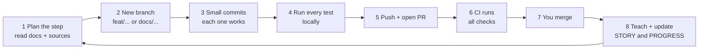
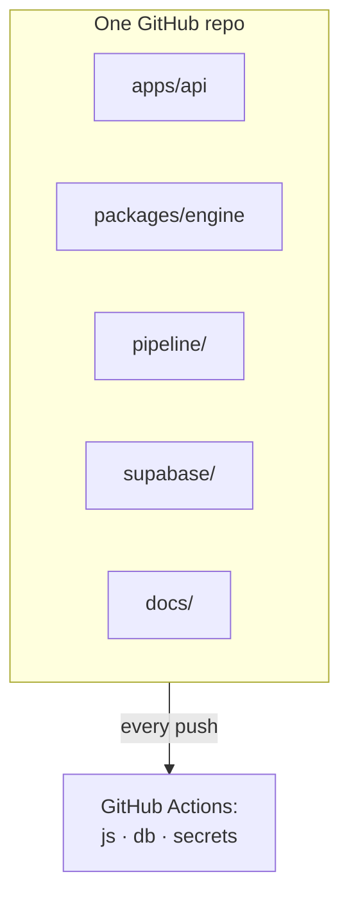
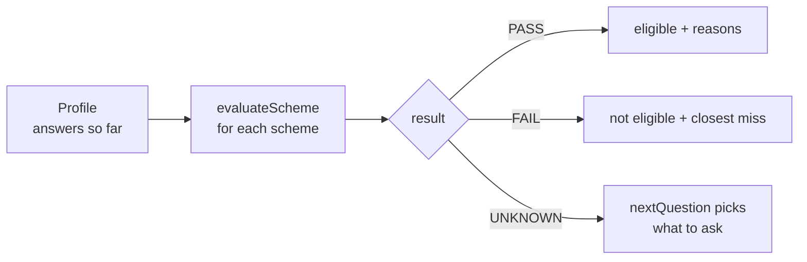

# PROGRESS: the build log
*Every step we have finished, in order: **what** we built, **how** we built it, what went wrong, and how we know it works. Simple English. A new entry is added after every step.*

> **[STORY.md](STORY.md)** explains the project as a story (the *why*). **This file** is the detailed diary (the *how*). Read STORY first if you're new.

**Latest:** Step 15, the web app in English + Bengali (2026-10-21) · Step 14 (staging database) waits on your Supabase account · **Next:** `POST /screenings` and the staging database decision

---

## How every step is built (our routine)

Every step follows the same loop. Once you know this loop, you know how the whole project was built.

**Rules we never break:**
- Small commits, each one working; no giant "did everything" commits.
- No `Co-Authored-By` lines in commits.
- Never store name, phone or Aadhaar. Never commit secrets.
- Free tiers only.
- Don't scrape myScheme; use official ministry and state pages.
- Never write "used by" or a number we didn't measure.

---

## The tools we use (and why)

| Tool | What it is | Why we use it |
|---|---|---|
| **pnpm** 10 | Installs packages | Fast; handles many packages in one repo |
| **Turborepo** 2 | Runs tasks across the repo | One command runs lint/test for every package, and caches results |
| **TypeScript** 6.0 | JavaScript with types | Catches mistakes before running. Pinned to 6.0 because TS 7 breaks the linter |
| **ESLint + Prettier** | Code checker + formatter | Same style everywhere, automatic |
| **Vitest** | Test runner | Fast tests for the engine and API |
| **fast-check** | Property testing | Throws random inputs to find edge cases |
| **Ajv** | JSON Schema checker | Proves every rule file has the right shape |
| **Fastify** 5 | Web server | Fast, with good TypeScript support |
| **Zod** 4 | Input checker | Rejects bad or private fields in requests |
| **Supabase** | Postgres database + login | Free; row-level security; runs locally too |
| **pgTAP** | Database tests | Tests security rules inside Postgres |
| **GitHub Actions** | CI robots | Run every check on every push |
| **gitleaks** | Secret scanner | Stops passwords or keys being committed |
| **Vercel** | Hosting | Free; runs the API in Mumbai |
| **Python** 3 | Scripts | Pipeline: seed generator, checklist generator |
| **Jina Reader / curl** | Page fetchers | Save official pages as text |

---

## Step 0: Planning and docs (2026-10-18)

**Goal:** decide *what* to build and *how*, before any code.

**How we did it:**
1. You gave the brief: a voice-first scheme finder, free tiers, a 6-week plan alongside placement prep.
2. I proposed a doc set; you approved it.
3. Wrote each doc as its own commit.
4. Re-planned to 6 weeks, with buffer days and commit-sized tasks.

**What we built:**
- [PRD](PRD.md): the problem, personas, v1/v2 scope, target metrics.
- [ARCHITECTURE](ARCHITECTURE.md): diagrams of every part.
- [7 ADRs](adr/README.md): why monorepo, Supabase, a pure engine, Vercel, Groq, Sarvam voice, offline.
- [DATA](DATA.md): the rule format.
- [EVALS](EVALS.md): how to score the AI.
- [TESTING](TESTING.md), [PRIVACY-SECURITY](PRIVACY-SECURITY.md), [DISCOVERY](DISCOVERY.md), [RUNBOOK](RUNBOOK.md), [BUILD-PLAN](BUILD-PLAN.md), [CONTRIBUTING](../CONTRIBUTING.md).

**Result:** you read and approved them; only then did code start.

---

## Step 0b: Design direction (2026-10-18)

**Goal:** decide how the product looks.

**How we did it:**
1. Wrote image prompts for 3 styles and generated test images (round 1). Set up a stronger round 1b on a Kaggle T4 GPU (SDXL, 24 images).
2. Round 1 showed the fast model ignored style words. Then the direction changed: illustrated people don't fit a real-world problem, so round 1b was superseded before review.
3. Switched to **real licensed photos** from Unsplash, checking each one's licence on its page.
4. You locked 5 photos (#1, #4, #6, #7, #9) for the landing page.

**What we built:** [DESIGN.md](DESIGN.md), [design-refs/CREDITS.md](design-refs/CREDITS.md) (every photo with licence and status), [PROMPTS.md](design-refs/PROMPTS.md).

**Rule we set:** a photo is never captioned as a user or beneficiary. AI images only for objects (papers, stamps), never people.

---

## Step 0c: Tools set up (2026-10-18)

**Goal:** get the helper tools ready.

**How:** installed the reverse-engineering tool REA (as an MCP server in Claude Code) and Agent-Reach (a command-line tool with a Claude Code skill), with your approval. Moved the repo to `~/code/SchemeMatch` and installed pnpm and the Supabase CLI.

**Rules:**
- REA is used only on software you own or may examine.
- Agent-Reach is used only with a secondary account, never your main ones.
- Security testing is a separate session, run later against staging.

---

## Step 1: Foundation: monorepo, CI, database (PR #1, 13 commits, 2026-10-18 → 19)

**Goal:** a solid base that every later step builds on.

**How we did it:**
1. **Monorepo:** `pnpm-workspace.yaml` + `turbo.json`, shared TypeScript/ESLint/Prettier config.
2. **Engine package:** `packages/engine` with the rule-format types (empty logic for now).
3. **CI:** `.github/workflows/ci.yml` with 3 jobs:
   - *js* job: format check → lint → typecheck → tests;
   - *db* job: start Supabase → database tests;
   - *secrets* job: gitleaks scan.
4. **Database:**
   - `supabase init`; local ports moved to 553xx so your FollowUp project can run at the same time;
   - first migration: tables `schemes`, `scheme_rule_versions`, `scheme_documents`, `scheme_texts`, `worker_profiles`, `organisations`.
5. **Security (RLS):**
   - every table starts *closed*;
   - the public may read only `live` schemes and their current rule version;
   - only admins may write, through an `is_admin()` check.
6. **Tests for security:** `supabase/tests/rls_schemes.test.sql` (pgTAP) proves each rule, for example "a stranger can't see a draft scheme".
7. Pinned every third-party GitHub Action to an exact commit, for supply-chain safety.

**Problems and fixes:**
- `supabase migration new` waited for keyboard input → we write migration files directly.
- An RLS policy checked the wrong table's `id` → name every column with its table.
- A blocked UPDATE returns "0 rows", not an error → the test checks the row count.
- TypeScript 7 broke the linter → pinned 6.0.3.
- The secret scan needed permission to read PR commits → added `pull-requests: read`.

**Result:** CI green with all 3 jobs; you merged PR #1.

---

## Step 2: Golden set, first 10 schemes (PR #2, 27 commits, 2026-10-19)

**Goal:** a hand-checked answer key of scheme rules.

**How we did it:**
1. Wrote the labelling guide [pipeline/golden/GUIDE.md](../pipeline/golden/GUIDE.md): one condition per criterion, exact quotes, numbers exactly as written.
2. Made the scheme list [pipeline/catalog.csv](../pipeline/catalog.csv) (30 planned).
3. Fetched each official page and saved it to `pipeline/sources/<slug>.txt` with URL, date and a sha256 fingerprint. Swapped out sources that wouldn't load.
4. Wrote one JSON file per scheme in `pipeline/golden/schemes/`, with the exact quote for every condition.
5. Added a JSON Schema (`rule.schema.json`) and a test that every file matches it.
6. Added a test that every quote exists word for word in the saved page.
7. Wrote hand-made test cases per scheme in `packages/engine/test/profiles/`, plus 6 personas (Sunita and others).
8. Wrote `make_verify.py`, which generates [VERIFY.md](../pipeline/golden/VERIFY.md), a checklist for your human review.

**Problems and fixes:**
- **You caught missed criteria** (Sanjay Gandhi's categories). The cause: I had searched keywords instead of reading whole pages.
  - Fix: a full re-read of all 10 → 5 files fixed (Sanjay Gandhi, PM-KISAN exclusions, APY age, PMMVY categories, old-age pension note).
  - Then added a **bullet-coverage test**: it fails if any line of a page's eligibility list has no matching rule. It immediately caught more PMMVY gaps.
- APY: "joining closes at the 40th birthday" means age 18–39 in whole years.
- The CSV writer used Windows line endings and broke a test → fixed with `lineterminator`.

**Result:** 10 schemes, every quote verified, every bullet covered; labelled "AI-drafted, AI-checked" until your review.

---

## Step 2b: Five West Bengal schemes (PR #3, 10 commits, 2026-10-19)

**Goal:** add West Bengal.

**How:**
1. Saved the full text of 5 wb.gov.in pages: Annapurna, Taposili Bandhu, Jai Johar, Shikshasree, Medhashree.
2. Labelled them with the same rules and tests.
3. Defined `education_level` values (`class_1`…`class_12`, `diploma`, `undergraduate`, `postgraduate`).
4. Added a West Bengal persona (SC widow, 62).
5. Marked **Lakshmir Bhandar discontinued** (per you: ended after the change of government); wb.gov.in no longer lists it.

**Result:** 15 schemes.

---

## Step 3: The engine (PR #4, 10 commits, 2026-10-19)

**Goal:** code that applies rules to a person's answers.

**How we did it (tests first):**
1. `types.ts`: the shapes of Profile, Condition, Group and Result.
2. `condition.ts`: checks one condition (`eq`, `in`, `lt`, `between`…). Returns UNKNOWN if the field wasn't answered.
3. Property tests (`condition.property.test.ts`): random inputs prove that `lt`/`gte` and `lte`/`gt` are exact opposites, that `between` equals `gte` AND `lte`, and that answering an unrelated question never changes a result.
4. `logic.ts`: AND (`all`) and OR (`any`) with three values, tested with full truth tables.
5. `scheme.ts`: one scheme → result + reasons (from quotes) + closest miss + missing fields; checks the state first.
6. `questions.ts`: picks the next question that matters most, and screens all schemes at once.
7. `engine-profiles.test.ts`: runs every hand-written case and persona through the engine.
8. Removed code that could never run (found by the coverage report) and **required 100% coverage in CI**.

**Result:** all hand-written cases pass; 100% coverage.

---

## Step 4: The API (PR #5, 8 commits, 2026-10-19)

**Goal:** let apps ask the engine over the internet.

**How we did it:**
1. Created `apps/api`.
2. `repository.ts`: a `SchemeRepository` interface. The first version reads the golden files.
3. `profile-schema.ts`: a strict Zod schema built from the engine's field list. Unknown keys (`name`, `phone`, `aadhaar`) → 400.
4. `build-app.ts`: routes `/health`, `/schemes`, `/eligibility`, plus:
   - a standard error format;
   - a disclaimer on every result;
   - log redaction;
   - rate limit 60/min.
5. Local dev server on port 3001.
6. Tests for routes, validation, rate limiting, errors and log redaction.

**Problems and fixes:**
- Too many requests returned 500, not 429 → the error builder now sets 429.
- The rate limiter could be fooled by a fake IP header → it now reads one configured header (`CLIENT_IP_HEADER`) that the host sets.

**Result:** API tests green; you merged.

---

## Step 5: Schemes in the database (PR #6, 10 commits, 2026-10-19)

**Goal:** serve schemes from Postgres, as the real system will.

**How we did it:**
1. Migration 2: added `unmodelled` and `ambiguous` columns to rule versions.
2. `make_seed.py`: generates `supabase/seed.sql` from the golden files. IDs are UUID v5 from the slug, so they never change between runs.
3. pgTAP test: the seed loads every scheme as live with a current rule version.
4. `supabase-repository.ts`: reads with the public (anon) key only, so RLS guarantees it never serves drafts. Results are cached for 60 seconds.
5. **Parity test:** the database must serve *exactly* what the golden files contain.
6. CI's db job now also runs the API integration tests against local Supabase.
7. The API picks the database when `SUPABASE_URL` and `SUPABASE_ANON_KEY` are set, and the files otherwise.

**Problems and fixes:**
- Old RLS tests assumed an empty database → scoped them to their own test data.
- Turborepo hid the env vars from tests → declared them in `turbo.json`.

**Result:** the same answers from files or the database, proven by a test.

---

## Step 6: Going live on Vercel (PRs #7, #8, #9, 2026-10-19 → 20)

**Goal:** a real public URL (staging).

**How we did it:**
1. Planned a Supabase staging project. But the free plan allows 2 projects, both used by your live demos (Cortexa, FollowUp), and we didn't pause them.
   - Decision: **no online database yet**.
   - `bundle-schemes.mjs` packs the golden schemes into the API at build time.
2. Created a Vercel project `schemematch-api`, connected to GitHub, region **bom1 (Mumbai)**.
3. Made `src/index.ts` the single server entry.
4. Fixed 3 deploy bugs, one at a time, each tested on a *preview* URL before merging:

| Bug | Fix |
|---|---|
| "No entrypoint found" | `import fastify` directly in `src/index.ts` |
| Crash: module not found | `.js` import paths; the engine is compiled to `dist/`. Proved it by building locally and running with plain Node |
| Hang with no logs | Removed `await` on `app.listen()` |

5. Region was Washington at first → set the project to `bom1`; checked the `x-vercel-id` header.
6. Turned off Vercel's login wall, because the API serves only public scheme data and rejects anything that isn't a profile field. (The rate limit is weaker than first written: it counts per server instance, so a burst spread over instances isn't blocked. Found in the audit; see Step 11.)
7. Wrote the lessons into [RUNBOOK.md](RUNBOOK.md).

**How we checked it works (on production):**
- `/health` → `{"ok":true}`;
- `/schemes` → all schemes;
- West Bengal widow → the right 3 schemes;
- sending `aadhaar` → 400;
- served from `bom1::bom1`, about 0.2–0.4 s.

**Live URL:** https://schemematch-api-zakuroooos-projects.vercel.app (⚠️ *not* `schemematch-api.vercel.app`; that one is someone else's).

---

## Step 7: Schemes 16 to 30 (PR #10, 3 commits, 2026-10-20)

**Goal:** finish the 30-scheme answer key.

**How we did it:**
1. Listed every scheme page on wb.gov.in and Maharashtra's SJSA site.
2. **Found:** 5 West Bengal schemes (Kanyashree, Krishak Bandhu, Rupashree, Swasthya Sathi, Taruner Swapna) are no longer listed → marked `unlisted`.
3. Fetched 22 candidate pages:
   - Maharashtra via Jina Reader;
   - West Bengal by direct fetch, converted with a script I first proved gives a **byte-identical** copy of an existing page.
4. Read each page in full and picked 15 with at least one rule the app can check. For skipped ones (PMAY-G, PM SVANidhi, Namo Shetkari, MJPJAY), the catalog says why.
5. Wrote the 15 golden files and their test cases with a script, then formatted them.
6. **Checked each persona's new matches by hand** before updating expectations (e.g. 72-year-old BPL widow → Shravanbal). One persona was missing an answer → added `is_student: false`.
7. Regenerated the seed, the API bundle and VERIFY.md; moved counts from 15 to 30.
8. Ran everything: engine 503 ✓, API 35 ✓, database 23 ✓, parity 4 ✓.

**Tricky cases handled honestly:**
- OBC income limit not on the page → not invented; noted as ambiguous.
- "Class IX (Madhyamik)" contradicts itself (Madhyamik is the Class 10 exam) → not modelled.
- Neo-Buddhist students → answer SC (noted).
- Shravanbal amounts are from 2019 → the newer Nagpur figure is noted.

**Result:** 30 schemes: 15 central, 6 Maharashtra, 9 West Bengal.

---

## Step 8: Story doc (PR #11, 2026-10-20)

**Goal:** one simple place to understand the project.

**How:**
1. Wrote [STORY.md](STORY.md).
2. Drew 3 pictures as SVG (`docs/story/`), and checked each by rendering it. This caught a wrong example: Sunita does *not* get the widow pension at 38, so the picture was fixed.
3. Added 9 Mermaid diagrams, and checked that all 9 render in a browser.
4. Marked unmeasured claims as goals.

---

## Step 9: This build log (2026-10-20)

**Goal:** a detailed diary of *how* each step was built.

**How:** rebuilt the history from the git log (every PR and commit), the files in the repo and our session notes; wrote this file and linked it from STORY.md and the docs index.

---

## Step 10: AI rule-extraction pipeline (Week 3, branch `feat/extraction-pipeline`, 2026-10-20)

**Goal:** an AI drafts rules from the same saved pages; we score it honestly against the 30-scheme answer key.

**How we did it:**
1. **Python project** in `pipeline/`, managed by `uv` (fast installer with a lock file), tested with `pytest`.
2. **`fetch.py`:** moved the two page cleaners into code (`wb` for wb.gov.in, `jina` for others).
   - Proved the code still makes a byte-identical copy of Taposili.
   - `--check` re-hashes every saved page; all 30 match.
3. **`validate.py`:** three checks on every AI rule:
   - shape (the engine's own `rule.schema.json`);
   - quote (must be in the page; a small fuzzy allowance for line breaks);
   - value (e.g. age 0–120, caste only SC/ST/OBC/General/EWS).

   A bad rule is dropped and counted as wrong. All 30 golden files pass.
4. **`score.py`:** matches AI rules to golden rules → precision, recall, F1, exact-match %, and one label per mistake (`wrong_operator`, `wrong_value`, `missed_condition`, `invented_condition`…). Golden vs itself = a perfect 1.0.
5. **3 practice examples** (PM Internship, WB post-matric, PM SVANidhi), all **outside** the answer key, with a test that enforces it (the leakage rule).
6. **`prompt.py` + `extract.py`:**
   - prompt v1 from the guide's rules and the field list;
   - Groq call with a strict JSON schema, temperature 0, `reasoning_effort: low`;
   - retries on rate limits; records tokens and seconds;
   - tested with a fake Groq (no internet needed).
7. **`report.py`:** writes `reports/eval-<date>.md` in the EVALS format, re-scoring saved answers without calling the model again.
8. **CI:** a new `pipeline` job runs all Python tests and the source hash check.

**Problems and fixes:**
- **Security review finding:** an inner `all` group emptied by the validator would PASS everyone, which widens a rule.
  - Fix: drop it and record why; also reject groups that have both `all` and `any`.
  - Then fixed the scorer so a dropped rule is counted once, not twice.
- **Size limit:** Groq allows about 8,000 tokens a minute. Instructions + examples are ~3,200 tokens, and 3 long PDF pages (APY, PM-KISAN, PMMVY) can't fit.
  - Decided **before** any run: cap answers at 2,000 tokens, don't retry "too large", and score those 3 as misses.
  - Splitting pages is the next experiment.
- Swapped one practice example (Rajya Khadya Suraksha → PM Internship). Two examples with no checkable rules could teach the AI to answer "nothing".

9. **Your key:** you pasted it into a hidden prompt in the terminal, which saved it to `pipeline/.env` (git-ignored, readable only by you). I never saw it, and no file in the repo contains it (checked).
10. **The run:** 30 schemes × 2 models, about 30 minutes, then the report: [reports/eval-2026-10-20.md](../reports/eval-2026-10-20.md).
11. **Hand spot-check** of 5 raw answers against their pages, written up in the report's notes.

**First results (dev set, AI-checked answer key):**

| Model | F1, schemes with a usable answer | F1, all 30 | Exact | Answers that failed |
|---|---|---|---|---|
| A: gpt-oss-120b (big) | **0.87** (26 schemes) | 0.78 | 50% | 3 too large + 1 bad JSON |
| B: gpt-oss-20b (small) | 0.59 (22 schemes) | 0.43 | 13% | 3 too large + 5 bad JSON |

**What the spot-check found:**
- A **scorer bug:** a one-item group was counted as a grouping error. Fixed, with tests, before the final report.
- Real model mistakes:
  - NFBS: read the dead breadwinner's age as the applicant's;
  - IGNWPS: "widow" became `gender`, and BPL became `income < 0`;
  - pre-matric: the SC/ST income limit was applied to OBC too.
- Groq "strict" mode **checks** the JSON after it's written; it doesn't force it. The small model broke it 5 times.

**How we checked it:**
- 51 Python tests pass.
- Sabotage test: changing PMUY's `gte` to `gt` shows up as exactly one `wrong_operator`.
- Every raw answer is committed in `pipeline/runs/`, so anyone can re-score without calling the AI.

---

## Step 11: Full audit of everything so far (2026-10-20)

**Goal:** you asked me to check everything (code, data, AI answers, docs) for anything false, stale or broken, and fix it before moving on.

**How we did it:**
1. **Live checks:** production `/health`, 30 schemes served, the West Bengal widow's 7 schemes, 140 requests to test the rate limit.
2. **AI answers:**
   - read all 15 errors of the big model against the pages;
   - checked the size estimate against Groq's real token counts (within ±4%, so the 3 "too large" pages really were too large);
   - re-checked every label.
3. **Answer key:** every number in the 30 benefit and how-to-apply texts checked against its saved page; all 30 benefit sentences read.
4. **Docs:** searched every doc for claims the code doesn't back up.
5. **Security:** scanned the whole git history for keys and tokens (none found); checked what the logs record.

**Problems found, and what was done:**

| # | Problem | Fix |
|---|---|---|
| 1 | Logs recorded each visitor's network address, but PRIVACY-SECURITY promises no IPs in logs | Address and port now redacted, with a test that failed before the fix |
| 2 | Rate limit is per server instance: 70 parallel requests all got through | Docs now say so honestly (measured); a shared store (Upstash) is still planned |
| 3 | The live staging API serves rules not yet human-reviewed, against PRD V1-2 | Clearly labelled "testing only" in README and RUNBOOK |
| 4 | 9 schemes said "Apply through the official channel described on the source page" | Replaced with the real steps from each page; one unsourced phrase I wrote myself was removed |
| 5 | Validator let through conditions nobody can meet (`income lt 0`) | Now dropped, with tests; report regenerated and the small change explained |
| 6 | The answer key's `is_student` + `education_level` habit wasn't written down, so 2 of the AI's "misses" came from an unwritten rule | Written into GUIDE.md |
| 7 | Stale or false doc lines: "60 rule sets", "hand-labelled by you", "her 5 schemes", Agent-Reach called an MCP, a planned cron described as working, the TESTING file format and CI steps, a DATA example breaking our own rule, README still on "Week 2" | All corrected |
| 8 | Only 2 of 30 schemes list their documents | Not hidden any more: STORY says so; filling them is a planned step |

**Still open (needs your decision or your time):**
- CLAUDE.md is in 2 old commits (no secrets in it). Removing it needs a history rewrite and force-push, so you decide.
- Your human review of the 30 schemes.
- 5 discovery conversations.

**How we checked it:** engine 503 · API 36 · pipeline 52 · database 23 · database-vs-files parity 4, all passing.

---

## Step 12: Saving screenings safely (Week 3 step 2, branch `feat/screenings`, 2026-10-20)

**Goal:** let the app save a screening. A weak network can send the same request twice, so a retry must **never** create a duplicate. Users must also be able to delete their data.

**Your decision:** no hosted database yet (both free Supabase slots run your demos). So we built and tested everything on local Supabase + CI, and staging answers "503: saving is not set up yet". Hosting gets decided in Week 4, together with worker login.

**How we did it:**
1. **Migration 3:**
   - two tables, `screenings` (the answers, with no name, phone or ID) and `matches` (one row per scheme: PASS/FAIL/UNKNOWN, the reason, the rule version that decided it);
   - RLS on with no policies, and table rights taken away from the public keys;
   - a database function `save_screening` that saves **exactly once** per `idempotency_key`, using a unique index.
2. **Database tests (pgTAP, 15 new):**
   - the public key can't read, write or call anything;
   - a retry returns the same stored screening; a reused key with different answers is refused; delete removes the matches too.
   - **Sabotage:** granting the public key access made these tests fail.
3. **API:**
   - `POST /screenings` with an `Idempotency-Key` header: **201** first time, **200** with the stored result on a retry, **409** if the key comes back with different answers, **503** with no database;
   - `DELETE /screenings` with an `X-Install-Id` header (delete my data).
4. **Server-only key:** saving uses `SUPABASE_SECRET_KEY`. It lives only on the server, never in an app, never in a log.
5. **Tests:** 15 route tests with an in-memory store, plus 5 tests against the real database.

**The key test, and the sabotage that proves it:**
- 5 identical requests sent **at the same moment** → exactly **1** screening.
- Then I swapped the database's unique key for the "obvious" app approach: check whether it exists, then insert. The same 5 requests created **5 screenings**, because all of them checked before any had inserted. Only the database can make this exactly-once.

**Problems and fixes:**
- **Tests caught a bad stored reason.** For state schemes the first "reason" was always the state check ("Scheme of the state WB…"), which says nothing about why someone qualifies. The engine now exports that text, so the API skips it.
- **Security review:** the delete route first put the install ID in the URL. It works like a password, and URLs end up in access logs, so it moved to a header. A test proves it never appears in logs.
- One stale test title ("same five schemes" → eleven).

**How we checked it:**
- Engine 503 · API 51 (+7 that need a database) · database 38 · pipeline 52, all passing.
- Manual curl on a local server: 201 → 200 → 409 → delete 1 → public key refused; the install ID appears 0 times in the server log.

---

## Step 13: CI fix, the held-out exam, and your discovery kit (2026-10-21)

**Goal:** you asked me to do your Week 3 jobs carefully, and fix anything else I find along the way.

**What I did, and what I could not do for you:**
1. **PR #15 secret-scan failure.** Ran the same scanner (gitleaks 8.30.1) locally. It was a false positive: a made-up test UUID named `KEY`. I renamed it and listed that one exact finding in `.gitleaksignore`, without a broad allowlist. The whole history scans clean.
   - *My own mistake on the way:* the first rename didn't happen (macOS `sed` has no `\b`), so the commit message was briefly false. I caught it and fixed it before pushing.
2. **Labelled the held-out 10** before any model saw them: same guide, exact quotes, bullet-coverage tests; kept out of the API, the seed and every prompt. Leakage tests now cover them.
3. **Ran the frozen prompt v1 once** on them, then read **every** error of the big model against its page.
4. **Your discovery kit** is in [DISCOVERY.md](DISCOVERY.md) §0: who to contact, a first message in English, Hindi and Bengali, a consent line, and a note routine.
   - **The conversations themselves must be yours.** An invented interview would be a false claim.

**The result, honestly:**

| | Big model F1 | Small model F1 |
|---|---|---|
| Dev set (30) | 0.78 | 0.43 |
| **Held-out (10, final)** | **0.53** | 0.33 |

Why lower:
- I chose harder schemes on purpose (OR rules, districts, two income limits);
- there are only 22 conditions;
- the models are weak at **structure**.

One failure was **our** schema's fault: it allows no OR at the top. One label (MUDRA "above 18") is debatable, and was flagged before the run. **Not fixed yet on purpose:** changing the prompt after seeing held-out answers would be tuning on the test, so prompt v2 needs a fresh held-out set.

**Bugs found and fixed along the way:**
- **Engine:** district and occupation now match without case or extra spaces ("gadchiroli " = "Gadchiroli"). Found while labelling the first scheme that names districts.
- **Interview guide:** question 8 asked to show a demo that doesn't exist yet.
- **My own slips, caught before pushing:**
  - a formatter run from the wrong folder touched a generated file;
  - one commit held the wrong file;
  - a report stamp pointed at a commit that no longer existed.

**How we checked it:** engine 566 · API 51 (+7 with a database) · database 38 · pipeline 52; secret scan clean on the full history.

---

## Step 14: Staging database, part 1 (Week 4 step 1, branch `feat/staging-db`, 2026-10-21; waiting on you)

**Goal:** a hosted database for staging, so worker login and saved families can work there.

**Your decision:** your own second Supabase account, holding only SchemeMatch staging. The risk is written down: Supabase's rules ban "an excessive number of accounts"; two is a grey area.

**Done so far:**
- A daily **keep-alive** route (`GET /cron/keepalive`): one real database read, because free projects pause after 7 quiet days.
  - Only Vercel's cron may call it: it carries `CRON_SECRET`, checked in constant time, and with no secret set, everyone is refused.
- A daily Vercel cron at 05:00 UTC (10:30 IST).

**Waiting on you:**
1. Create the account and the `schemematch-staging` project (Mumbai).
2. `supabase login` + `link`, where you type the password.
3. Add the 3 keys in Vercel.

Then I push the schema and run every test against staging.

---

## Step 15: The web app, English + Bengali (Week 4 step 2, branch `feat/web-shell`, 2026-10-21)

**Goal:** a screen a field worker can use: fill a family's answers, see likely schemes with reasons, in English or Bengali.

**How we did it:**
1. **Next.js app** in `apps/web`: Next 16, React 19, next-intl, Tailwind 4, each version out at least two weeks. `/en` and `/bn` are prebuilt pages.
2. **One source of truth:** the engine now exports the allowed answers (genders, castes, classes…) as lists. Both the API's validation and the form use them.
3. **The form** asks all 16 fields; a blank stays blank ("not answered" ≠ "no").
4. **The browser calls the API directly**, not our server. Otherwise every user would share one rate limit.
   - The API got a **CORS allowlist**, with tests against look-alike addresses.
5. **Bengali:** every interface string is in `bn.json`, with tests that both languages have the same keys and that Bengali text really is Bengali. **You should read every Bengali line once.**
6. **Vercel project** `schemematch-web` (Mumbai); the API allows its addresses.

**Bugs found by using it in the browser (not by the tests):**

| Found | Fix |
|---|---|
| **False "why" reasons:** a widow was told "divorced women…" and "unmarried women over 35" (twice) for Sanjay Gandhi | The engine now takes reasons only from parts of the rule that passed, once each, never the state gate |
| **Other ways to qualify shown as requirements:** a widow had to "also confirm" orphans, devadasis… | New `kind: "alternative"` (GUIDE rule 7). Hidden when someone qualifies; shown as "may still qualify if…" when they don't. Also fixes a hidden false negative: PMMVY via an e-Shram card |
| A Maharashtra family saw all **9 West Bengal schemes** as "not eligible" | Counted in one line: "9 schemes are only for other states" |
| **Answers in the URL:** clicking before the page was ready put every answer in the address bar | No input names, POST only, button disabled until ready (checked in the server HTML and the browser) |
| Two language links were too small to tap (under 32px) | Every control is now at least 44px |
| The form box lost focus while typing (found in code review, before it ever ran) | Moved the field component out; a test fails if it comes back |

**My own slips, all caught before pushing:**
- a commit that wouldn't build alone (history rebuilt so every commit passes);
- "12 West Bengal schemes" in a message (it's 9);
- a format check whose failure my command hid.

**How we checked it:**
- engine 572 · API 67 · web 18 · pipeline 52, all passing; every commit passes on its own;
- the Sunita persona in the real browser, in both languages: her **11 schemes**;
- phone width: no sideways scrolling; no console errors.

---

## Running totals

| Thing | Count | How to check |
|---|---|---|
| PRs merged | 12 | GitHub |
| Golden schemes | 30 (15 central · 6 MH · 9 WB) + 10 held-out (5 central · 3 MH · 2 WB) | `pipeline/catalog.csv` |
| Hand-written test cases | 174 | `packages/engine/test/profiles/` |
| Engine tests | 572 | `pnpm turbo run test` |
| API tests | 67 (+7 that need a database) | same; the 7 run in CI's db job |
| Web tests | 18 | same |
| Database tests | 38 | `supabase test db` |
| Engine code coverage | 100% | CI enforces it |
| Human-reviewed schemes | 0 of 30 | `reviewed_by` in each file |
| Real user conversations | 0 of 5 | [DISCOVERY.md](DISCOVERY.md) |
| Pipeline (Python) tests | 52 | `cd pipeline && uv run pytest` |
| Eval reports | 2. Final held-out: big model F1 **0.53**, small 0.33 (dev set: 0.78 / 0.43) | [reports/](../reports/) |

---

## Next step

**Yours:**
1. Create the second Supabase account + `schemematch-staging` (Step 14).
2. Read the Bengali strings in `apps/web/messages/bn.json`.
3. Merge `feat/staging-db`, then `feat/web-shell`.
4. The 5 discovery calls.

**Mine, next:** worker login (Supabase Auth) and organisation rules, once the staging database exists.
