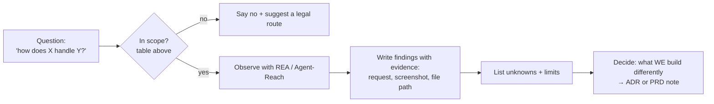

# REVERSE ENGINEERING — learning from how things work, legally
*Trigger: Pranay says "reverse engineer X". Tool: REA (MCP server `rea`, plus the `rea` CLI via `npx rea-agents`).*

## 1. Scope — what is allowed

| Target | Allowed? | How |
|---|---|---|
| Our own builds (SchemeMatch APK, web bundle, API) | ✅ Yes | REA static analysis: bundle size, what's inside the APK, leaked secrets, source maps shipped by mistake |
| Public websites — as a normal visitor | ✅ Yes, outside-in | REA browser observation: page structure, which requests a page makes, timings; plus Agent-Reach web reading |
| Public docs, talks, blog posts, app store listings | ✅ Yes | Agent-Reach (web, YouTube subtitles) |
| Open-source apps (licence permits study) | ✅ Yes | Read the source on GitHub; respect the licence when reusing |
| Third-party apps' binaries/APKs (e.g. Haqdarshak, myScheme, Umang) | ❌ No | Not ours, not authorised → no decompiling, no APK unpacking |
| Bypassing logins, rate limits, paywalls, protections | ❌ Never | — |
| Scraping myScheme | ❌ No | Its Terms of Use forbid bots (DATA.md §1) |

Rule of thumb: **we study behaviour and ideas, never copy code, content or assets**. Everything we build is our own implementation.

## 2. Workflow



## 3. Findings note (`docs/re-notes/YYYY-MM-DD-<target>.md`)
```
Target & why: …
In scope because: …
Method: REA tool/command used, browser steps
Observations (each with evidence): …
Unknowns / limits: …
What we'll do (our own design): …
```

## 4. Good uses for this project
- **Our APK audit before each release:** size breakdown, no API keys or service-role key in the bundle, no source maps, permissions list is minimal.
- **Our web bundle:** what ships to the browser, JS size per route, no secrets.
- **Public UX study:** how public scheme portals phrase eligibility questions and order them (as a visitor) → informs our question wording.
- **Performance comparison:** page weight and request count of public portals vs our landing page on a throttled connection.
