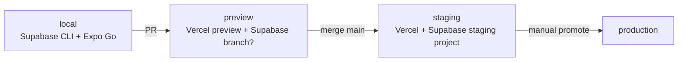

# RUNBOOK — running SchemeMatch in the real world
*Skeleton now; filled in as each piece is deployed. Sections marked ⏳ are written when staging exists.*

## 1. Environments

| Env | Web/API | DB | Who uses it |
|---|---|---|---|
| local | `pnpm dev` | Supabase local (Docker) | you |
| preview | Vercel preview per PR | staging DB, read-mostly | you, reviewers |
| staging | Vercel (staging alias) | Supabase project `schemematch-staging` | you, pilot testers |
| production | Vercel production | Supabase project `schemematch-prod` | real users |

*Supabase free plan allows 2 active projects — staging + prod use both. Preview DB branching may need a paid plan; check before relying on it.*

### Staging setup (one time)
1. **Supabase:** create project `schemematch-staging` in region `ap-south-1` (Mumbai), free plan.
2. Apply `supabase/migrations/*` in order. Load `supabase/seed.sql` (staging only: the schemes are AI-checked, not human-reviewed).
3. Run Supabase **security advisors** and fix every finding before step 4.
4. **Vercel:** new project from the GitHub repo, **Root Directory `apps/api`** (framework auto-detected as Fastify, entry `src/index.ts`, region `bom1` from `apps/api/vercel.json`).
5. Env vars (Production + Preview): `SUPABASE_URL`, `SUPABASE_ANON_KEY` (publishable key only, never service-role), `CLIENT_IP_HEADER=x-forwarded-for`.
6. Smoke test: `GET /health`, `GET /schemes?state=WB`, `POST /eligibility` with the Sunita persona; expect her 5 schemes.

### Staging status (2026-10-20)
- **Live URL: https://schemematch-api-zakuroooos-projects.vercel.app** (`/health`, `/schemes`, `POST /eligibility`). ⚠️ `schemematch-api.vercel.app` is **someone else's** project; never share it.
- **API live on Vercel** (project `schemematch-api`, region `bom1`, Fastify preset, root `apps/api`, build `cd ../.. && pnpm turbo run build --filter @schemematch/api`). It serves the **bundled** golden schemes; there is no database yet.
- **No staging database:** Supabase's free plan allows 2 active projects, and both are in use by live resume demos (Cortexa, FollowUp). Decide on the database in Week 3, when `POST /screenings` needs one.
- Vercel Authentication is **off** for this project, so the API is public. It only serves public scheme info, validates every input and is rate-limited.

### Deploy lessons (each one cost a failed deploy)
1. Vercel finds the Fastify entry by a **direct `import ... from "fastify"`** in `src/index.ts`.
2. Vercel compiles `.ts` to `.js` but **does not rewrite import paths**. Import local files with `.js` paths, and give shared packages a compiled `dist/` (`packages/engine`).
3. **Never `await app.listen()` at top level.** Vercel replaces `listen()`, and the awaited promise blocked startup forever (requests hung with no logs). Call `app.listen({ port })` without `await`, as in Vercel's docs.

## 2. Free-tier limits and what breaks first

| Service | Limit to watch (check current pricing page) | Symptom | Action |
|---|---|---|---|
| Supabase | Pauses after ~7 days idle; 500 MB DB | API 5xx on a quiet week | Weekly keep-alive cron; restore from dashboard |
| Vercel Hobby | Function invocations/duration, 1 region, cron frequency | 429 / throttled | Cache `/schemes` at the CDN; reduce cron frequency |
| Groq | Requests/tokens per minute/day | Pipeline 429s | Back-off + resume; pipeline is batch only |
| Sarvam | Free credits | Voice falls back to device | Watch fallback-rate metric; cap per install |
| Upstash Redis | Commands/day | Rate limiter errors | Fail open for reads, closed for writes |
| Expo EAS | Free build minutes/queue | Slow builds | Build locally when needed |

## 3. Deploy and rollback
- Web/API: merge to `main` → Vercel deploys staging. Promote to prod from the Vercel dashboard / MCP after the checklist below. **Rollback** = promote the previous deployment (instant).
- DB: migrations in `supabase/migrations/`, applied to staging first; every migration must be backward compatible with the previous app version (expand → migrate → contract).
- App: EAS build → internal testing track → release. Scheme data updates ship as a **snapshot**, not an app release.

**Pre-promote checklist:** CI green · migrations applied on staging · smoke test (screen one persona end to end in 2 languages) · no new Sentry/log errors in 15 min.

**API deploy setting:** set `CLIENT_IP_HEADER=x-forwarded-for` on Vercel so rate limiting is per user. Without it, everyone shares the proxy's IP. Locally, leave it unset so faked headers are ignored. Vercel's docs confirm the edge overwrites `x-forwarded-for` by default to prevent IP spoofing (checked 2026-10-20).

## 4. Scheme data refresh
Weekly Vercel Cron re-fetches each `official_url`, compares `source_hash`; changed → `needs_review` (stops matching) + a GitHub issue with the diff. You review within 7 days; `last_checked` shows on every scheme card.

### Run the rule-extraction pipeline (batch, on your laptop)
1. One time: create a free key at console.groq.com and put `GROQ_API_KEY=...` in `pipeline/.env` (git-ignored; never commit it or paste it in chat).
2. `cd pipeline && uv sync`
3. Check the saved pages are unchanged: `uv run python -m schemematch_pipeline.fetch --check`
4. Extract with both models: `uv run python -m schemematch_pipeline.extract --models A B`
   - This takes about 30–60 min, because of the 8K tokens-per-minute limit.
   - Stopping is safe: run the same command again and it resumes.
5. Score and write the report: `uv run python -m schemematch_pipeline.report runs/<run-id>` → `reports/eval-<date>.md`
6. Spot-check 3 raw answers in `runs/<run-id>/<model>/` against their pages before trusting the numbers.
7. Commit `pipeline/runs/<run-id>/` and the report together, so the numbers can be re-scored without calling the model.

Settings (models, temperature, reasoning effort, prices) are pinned in `pipeline/config.yaml`. Change one thing at a time, and keep every report.

## 5. Monitoring ⏳
Signals: API error rate, warm p95, voice fallback rate, eligibility requests/day, sync failures. Tooling decided at staging (Vercel logs + a free Grafana Cloud or Axiom tier).

## 6. Incidents ⏳
Severity: **S1** wrong eligibility shown or data exposure → hide affected schemes / rotate keys immediately · **S2** feature down · **S3** degraded. Every S1/S2 gets a short blameless note in `docs/incidents/`.

## 7. Secrets and rotation
Where each secret lives (names only, never values): `SUPABASE_SERVICE_ROLE_KEY`, `SUPABASE_URL`, `SARVAM_API_KEY`, `GROQ_API_KEY`, `UPSTASH_REDIS_REST_TOKEN`, `CRON_SECRET`. Rotate on any suspected leak and every 6 months.

## 8. Security testing
Once SchemeMatch has a running staging deployment, a separate dedicated session will set up security testing of that staging app (Pranay's own app only).
