# The SchemeMatch Story
*One place to understand the whole project: the problem, the idea, everything built so far, and what comes next. Written in simple English. This file is updated after every step. The newest entry is in the [change log](#11-change-log) at the bottom.*

> Want the detailed *how* of each step (commands, files, bugs, checks)? See **[PROGRESS.md](PROGRESS.md)**, the build log.

> **Where we are (2026-10-20):** Week 2 of 6 is finished early. **30 schemes** are labelled, the **engine** and **API** work, and the API is **live on the internet** in Mumbai. Next up: Week 3, the AI pipeline.

| Week | 1 | 2 | 3 | 4 | 5 | 6 |
|---|---|---|---|---|---|---|
| Focus | Data + engine | Engine + API | AI pipeline + interviews | Web dashboard | Mobile + voice | Polish + demo |
| Status | ✅ done | ✅ done (+ API live) | ⏳ next | ⬜ | ⬜ | ⬜ |

---

## Contents
1. [The problem](#1-the-problem)
2. [Our solution](#2-our-solution)
3. [Who it is for](#3-who-it-is-for)
4. [The big map: how the parts fit](#4-the-big-map-how-the-parts-fit)
5. [The journey so far, chapter by chapter](#5-the-journey-so-far-chapter-by-chapter)
6. [Five ideas you must be able to explain](#6-five-ideas-you-must-be-able-to-explain)
7. [Mistakes we made and what they taught](#7-mistakes-we-made-and-what-they-taught)
8. [What is next](#8-what-is-next)
9. [Where everything lives](#9-where-everything-lives)
10. [Words used in this project](#10-words-used-in-this-project)
11. [Change log](#11-change-log)

---

## 1. The problem

Meet **Sunita**. She is 38, a widow in Nashik, with two children in school. She studied till class 8 and owns an ₹8,000 Android phone.

The government has money set aside for people like her: pensions, insurance, cash for women, scholarships for her children. **But she does not know which schemes are hers.**

Why not?
- India has **4,000+ central and state schemes**.
- Every scheme's rules live in long documents, mostly in English.
- The people who qualify most (widows, small farmers, daily-wage workers, poor students) are the people least able to read those documents.

**So money meant for them is never claimed.**

> **The problem in one sentence:** People don't know which schemes they are entitled to, because finding out means reading rules they cannot read.
>
> Hinglish: Paisa sarkar ke paas hai, haq logon ka hai, but rules padhna mushkil hai, isliye log claim hi nahi karte.

This is a real gap. A funded company, Haqdarshak, exists only to solve it, with people on the ground. We are building a software version: voice-first, open source, with accuracy we actually measure.

---

## 2. Our solution

**SchemeMatch** asks a few simple questions **by voice, in your language** and tells you which schemes you are **likely** entitled to. For each one it shows:
- **why** you qualify, quoting the official rule;
- **what papers** you need;
- **where to go** to apply;
- what you **must still confirm**, for things the app can't check (for example "you are destitute").

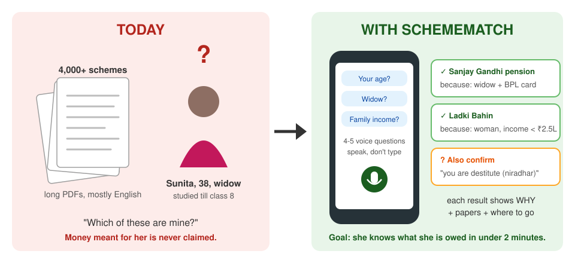

**What we promise, and what we don't:**
- ✅ We say "you are **likely** eligible, confirm at the office". We never say "you **will** get it".
- ✅ Every result links to the official source.
- ❌ We never store name, phone or Aadhaar.
- ❌ We don't apply on anyone's behalf, and we never pretend to be a government app.

---

## 3. Who it is for

| Person | Who they are | What they need |
|---|---|---|
| **Sunita** (main user) | 38, widow, Nashik, studied till class 8, cheap phone, patchy 4G | Speak, don't type. Know *what* she gets, *which papers*, *where to go*. |
| **Meena** (field worker) | NGO or ASHA worker who checks 20–30 families a day | A fast form, a list per family to print or share |
| **Arjun** (admin, that's you) | Keeps schemes and rules up to date | Add a scheme, review rules the AI drafted |

Sunita's journey, the way we want it to feel:

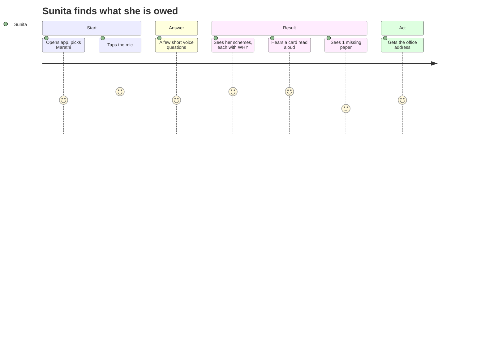

*These people are guesses until real conversations confirm them. That's the Week 3 discovery work.*

---

## 4. The big map: how the parts fit

Think of SchemeMatch as **a kitchen**:
- the **golden set** is the recipe book, checked by hand;
- the **engine** is the cook, who follows recipes exactly;
- the **API** is the waiter, who takes orders and brings food;
- the **database** is the pantry;
- the **app and website** are the restaurant tables where people sit.

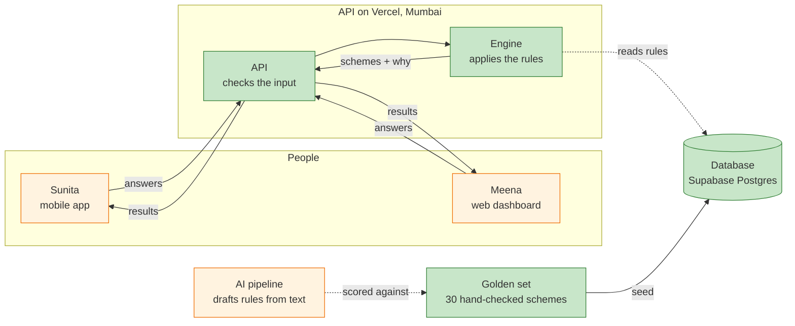

🟩 green = built · 🟧 orange = coming later

**One important design choice:** the engine is a **pure function**. The same answers always give the same result, and it doesn't touch the internet or the database. So the exact same engine can run **on the server** and later **inside the phone with no internet**.

> Hinglish: Engine ek calculator jaisa hai: same input, same output. Isliye phone mein offline bhi chalega.

---

## 5. The journey so far, chapter by chapter

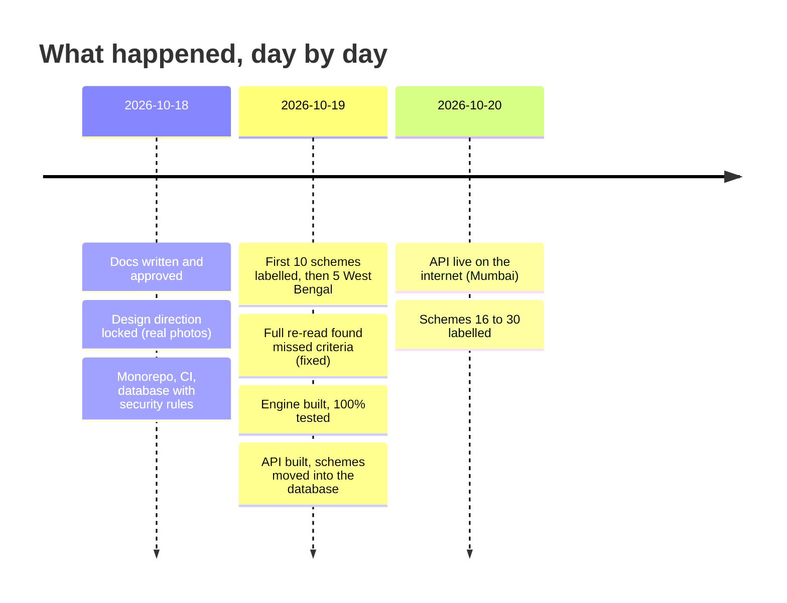

Each chapter below covers: **what** we built, **why**, and **what to say in an interview**.

### Chapter 1: Plan before code (the docs)
**What:** before writing any code, we wrote a full doc set: the problem (PRD), how it works (ARCHITECTURE), 7 big decisions with reasons (ADRs), the data format, how we test, how we measure the AI, privacy, and a 6-week plan.
**Why:** changing a doc is cheap; changing code later is expensive. It also proves to recruiters that you think like an engineer, not just a coder.
**Interview line:** "I wrote ADRs: short notes on why we picked Supabase, Vercel and Groq, and what we gave up."

### Chapter 2: How it should look (design)
**What:** we tried AI-drawn illustrations first. This is one test image:

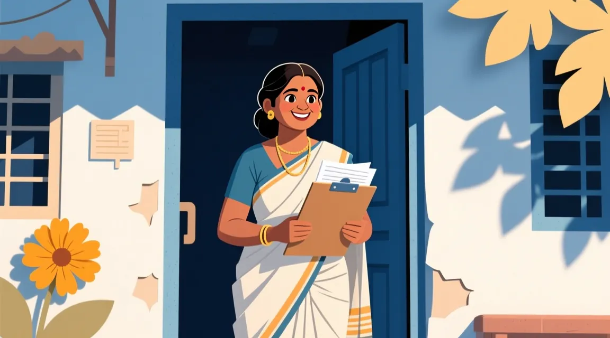

**Decision:** rejected. SchemeMatch is about real people and a real problem, so the landing page uses **real licensed photos** (5 locked, credits in [CREDITS.md](design-refs/CREDITS.md)), with AI only for objects like papers and stamps. Rule: a photo is never captioned as a user ("Sunita got ₹1,500"), because those people never agreed to that.

### Chapter 3: The foundation (monorepo, CI, database)
**What:**
- **Monorepo:** one GitHub repo holds the app, website, API, engine and pipeline, managed by pnpm + Turborepo.
- **CI:** on every push, GitHub automatically runs format check, lint, type check, tests, database tests and a secret scan.
- **Database:** Postgres on Supabase with **RLS** (row-level security). By default nobody can read anything; then we open exactly what's allowed (the public sees only *live* schemes).

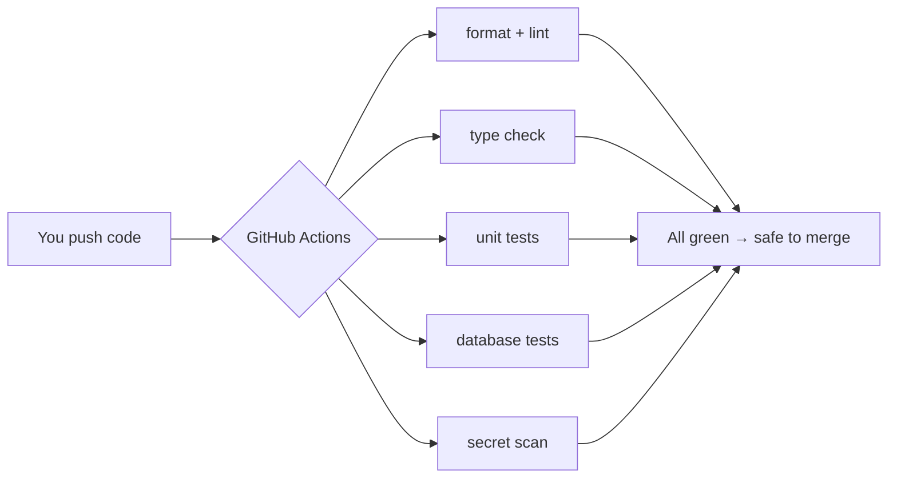

**Interview line:** "Security is default-deny: RLS starts closed and every opening is tested with pgTAP."
> Hinglish: Darwaza pehle band, phir sirf zaroori khidkiyan kholo, aur har khidki ka test likho.

### Chapter 4: The answer key (the golden set)
**What:** we hand-labelled the rules of **30 schemes** (15 central, 6 Maharashtra, 9 West Bengal). For each one:
1. Save a copy of the official page, with a fingerprint (sha256) proving it wasn't changed.
2. Turn each eligibility line into a rule, **with the exact sentence it came from**.
3. Things the app can't check (like "not a government employee") go into **"you must also confirm"**.
4. Unclear things go into **"ambiguous"** instead of being guessed.

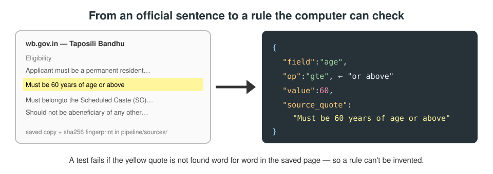

**Why it matters:** later, the AI will draft rules on its own, and we score it against this answer key. **If the key is wrong, every score is wrong.** That's why two automatic checks guard it:
- every quote must exist word for word in the saved page;
- every bullet in the page's eligibility list must be covered by some rule (so nothing is skipped).

**Honest label:** these 30 are *AI-drafted and AI-checked*. Your human review is still pending, and any accuracy number must say so.

### Chapter 5: The brain (the engine)
**What:** a function that takes a person's answers and a scheme's rules and says PASS, FAIL or UNKNOWN.

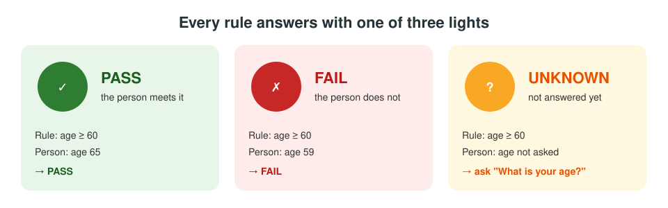

Rules can be **AND** groups (`all`: everything must pass) and **OR** groups (`any`: one is enough), even nested. A real example, Shravanbal pension in Maharashtra:

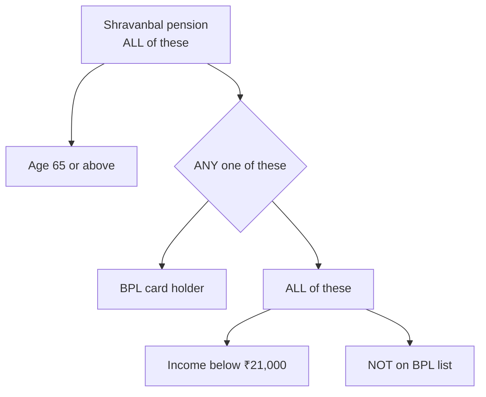

Then the engine:
- builds **reasons** from the official quotes ("because: Must be 60 years of age or above");
- finds the **closest miss** ("you missed only the age rule");
- picks the **next best question**, aiming for about 4–5 questions instead of 30 (a goal, not measured yet).

**Tests:** 174 hand-written cases, written from the official pages and not from the engine's output (the first batch was written before the engine even existed). Plus "property tests" that throw hundreds of random inputs at each comparison rule. 100% of the engine's code is covered by tests.

### Chapter 6: The waiter (the API)
**What:** a web server (Fastify) with three doors:

| Door | What it does |
|---|---|
| `GET /health` | "Are you alive?" → `{"ok":true}` |
| `GET /schemes?state=WB` | List schemes (central + one state) |
| `POST /eligibility` | Send answers → get schemes, reasons, next question |

Protections:
- **Strict input:** send `name`, `phone` or `aadhaar` and the API **refuses** (400). It is impossible to store them by mistake.
- **Rate limit:** 60 requests a minute per person, so nobody can flood it.
- **Logs hide answers:** private data never lands in logs.
- **Disclaimer** on every result.

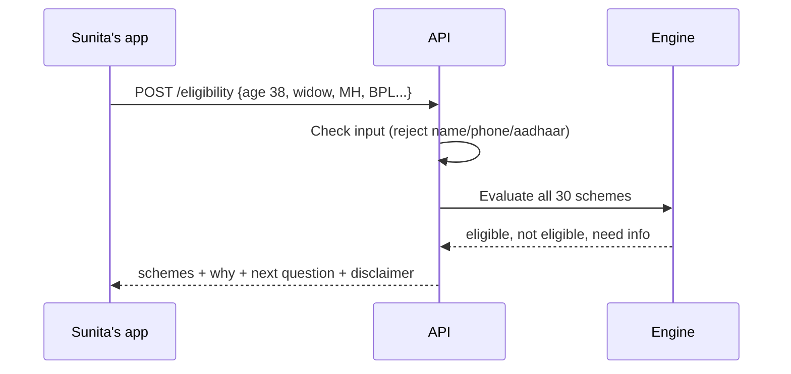

### Chapter 7: Moving rules into the database
**What:** the 30 schemes are loaded into Postgres from the golden files by a generator script, never typed by hand. A test proves **the database serves exactly what the golden files say**: same rules, every scheme.
**Why:** the golden files are the **single source of truth**. Everything else is generated from them, so the copies can't quietly drift apart.

### Chapter 8: Going live (staging deploy)
**What:** the API now runs on Vercel, in Mumbai, at
**https://schemematch-api-zakuroooos-projects.vercel.app**

⚠️ Never use `schemematch-api.vercel.app`: that is **someone else's** project.

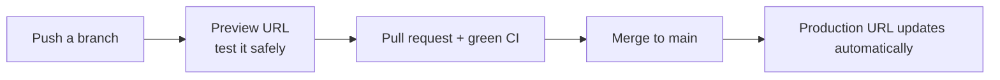

**No database online yet:** Supabase's free plan allows 2 projects, and both are used by your live portfolio demos. So the live API carries the 30 schemes **inside itself** (bundled). We decide on the database in Week 3, when saving screenings needs it.

It took **3 bug fixes** to get live. They're in [section 7](#7-mistakes-we-made-and-what-they-taught), and they're great interview stories.

### Chapter 9: Schemes 16 to 30
**What:** 15 more schemes, reading every official page in full:
- **Central:** NFBS, Ujjwala, Sukanya Samriddhi, PM-SYM, PM Vishwakarma, e-Shram, Jan Dhan.
- **Maharashtra:** Post-matric SC scholarship, SC fee reimbursement, Ramai Awas, Shravanbal.
- **West Bengal:** Pre-matric SC/ST/OBC, BMSSY, Migrant Worker Welfare, Student Credit Card.

**Found along the way:**
- Five West Bengal schemes (Kanyashree, Krishak Bandhu, Rupashree, Swasthya Sathi, Taruner Swapna) are **no longer listed on wb.gov.in**. They're marked "unlisted", because no page says they ended.
- A neat pair: Maharashtra's scholarship needs income **₹2.5 lakh or less**, while fee reimbursement needs **more than ₹2.5 lakh**. A family at exactly ₹2,50,000 gets the first, not the second, and tests check both edges.

---

## 6. Five ideas you must be able to explain

**1. Three-valued logic (PASS / FAIL / UNKNOWN)**
"Not answered" is not the same as "no". If we treated unknown as FAIL, we would wrongly tell Sunita she doesn't qualify. With OR rules: one PASS → PASS; all FAIL → FAIL; otherwise UNKNOWN, so ask a question.
> Hinglish: "Pata nahi" ko "nahi" mat samjho, warna sahi insaan ko mana kar doge.

**2. Single source of truth**
The golden files are the one true copy. The database seed, the bundle inside the API and the verification checklist are all *generated* from them. Edit one place; regenerate the rest.

**3. Tests written before the code**
The first test cases were written from the official pages before the engine existed, and new ones still come from the pages, never from the engine's output. So the tests check the *rules*, not what the code happens to do. When a test changes, there must be a source line that proves why.

**4. Default-deny security**
Start with everything closed, open only what's needed, and test each opening. The same idea in the API: unknown fields are rejected, not ignored.

**5. Honest numbers**
Never claim users or accuracy we haven't measured. "Built for", not "used by". "AI-checked", not "verified". "Goal: under 2 minutes", not "2 minutes".

---

## 7. Mistakes we made and what they taught

These are the best interview stories, because each one is a real problem you solved.

| # | What went wrong | Why | Fix | Lesson |
|---|---|---|---|---|
| 1 | Some scheme criteria were **missed** (you caught Sanjay Gandhi's missing categories) | I searched for keywords instead of reading the whole page | Re-read every page fully; added a **test that fails if any bullet is not covered** | Don't trust a skim, make a test that catches the miss |
| 2 | Atal Pension age was off by one | "Joining closes at the 40th birthday" means whole-year age 18–39 | Two quoted conditions | Boundaries need exact reading |
| 3 | Vercel said "no entrypoint found" | Its detector wants `import fastify` directly in `src/index.ts` | Added the import there | Platforms have hidden rules; read their docs |
| 4 | Live app crashed: "module not found" | Vercel compiles `.ts` to `.js` but **doesn't fix import paths** | `.js` import paths + a compiled engine | Tests passing locally ≠ works in production; **simulate production** (build, then run plain Node) |
| 5 | Live app **hung with zero logs** | `await app.listen()` waited forever on Vercel's hook | Don't await it | **No logs is a clue:** the app never finished starting |
| 6 | API ran in Washington, not Mumbai | Region set in the wrong place | Project setting → `bom1`; checked the `x-vercel-id` header | Verify, don't assume |
| 7 | Too many requests returned **500** instead of **429** | Error builder didn't set the status | Return 429 | Test the error paths, not just the happy path |

> Hinglish: Galti hona normal hai. Interview mein bolo: kya toota, kyun toota, kaise pakda, aur dobara na ho isliye kya test likha.

---

## 8. What is next

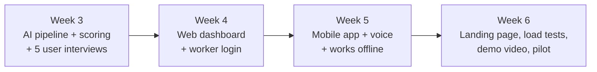

**Week 3 in simple words:**
1. Give an AI model the **same official pages** we saved.
2. It drafts rules in our exact format, with a quote for each rule.
3. Auto-reject any rule whose quote isn't in the page (so it can't invent rules).
4. Compare its rules with our 30-scheme answer key → **precision, recall, F1**.
5. Try 2 models and publish a fair comparison: accuracy, cost, speed.
6. **Your part:** talk to 5 real people (NGO workers, ASHA workers, CSC operators) and log what you learn in [DISCOVERY.md](DISCOVERY.md).

**Waiting on you:**
- Book the 5 discovery conversations.
- Human review of the 30 golden schemes (use [VERIFY.md](../pipeline/golden/VERIFY.md)).
- Tell me if the five "unlisted" West Bengal schemes really ended.

---

## 9. Where everything lives

| What | Where |
|---|---|
| Live API | https://schemematch-api-zakuroooos-projects.vercel.app |
| Code on GitHub | https://github.com/Zakuroooo/SchemeMatch |
| Schemes list | [pipeline/catalog.csv](../pipeline/catalog.csv) |
| Golden rules (answer key) | [pipeline/golden/schemes/](../pipeline/golden/schemes/) |
| Saved official pages | [pipeline/sources/](../pipeline/sources/) |
| Engine | [packages/engine/src/](../packages/engine/src/) |
| Hand-written test cases | [packages/engine/test/profiles/](../packages/engine/test/profiles/) |
| API | [apps/api/src/](../apps/api/src/) |
| Database setup | [supabase/migrations/](../supabase/migrations/) |
| The plan | [BUILD-PLAN.md](BUILD-PLAN.md) |
| How to deploy and run | [RUNBOOK.md](RUNBOOK.md) |

**Numbers today (all measured in the repo):** 30 schemes · 174 hand-written test cases · 503 engine tests · 35 API tests · 23 database tests · 100% engine code coverage.

---

## 10. Words used in this project

| Word | Simple meaning |
|---|---|
| **Scheme** | A government programme that gives money, cover or help |
| **Eligibility** | The rules that decide who can get a scheme |
| **Golden set** | Our hand-checked answer key of rules |
| **Engine** | The code that applies rules to a person's answers |
| **API** | A server other apps talk to over the internet |
| **Endpoint / route** | One "door" of the API, like `/eligibility` |
| **Monorepo** | One repo holding many projects that share code |
| **CI** | Robots that test every change automatically |
| **RLS** | Database rules saying who can see which rows |
| **Migration** | A script that changes the database structure, in order |
| **Seed** | Starting data loaded into the database |
| **Staging** | A real, public test copy of the app before real users |
| **Preview vs production** | Preview = a test link per branch; production = the main live link |
| **Rate limit** | A cap on requests per person per minute |
| **Pure function** | Same input → same output, no side effects |
| **Property test** | Thousands of random inputs checking a rule always holds |
| **Precision / recall / F1** | How much of what the AI said is right / how much of the truth it found / both combined |
| **BPL** | Below Poverty Line, a government list of poor households |
| **DBT** | Direct Benefit Transfer, money sent straight to a bank account |

---

## 11. Change log
*Newest first. One entry per finished step.*

| Date | Step | What changed |
|---|---|---|
| 2026-10-20 | Build log | [PROGRESS.md](PROGRESS.md) added: the detailed how of every step |
| 2026-10-20 | Story doc | This file created |
| 2026-10-20 | Step 2c | Schemes 16–30 labelled; 5 WB schemes marked unlisted (PR #10) |
| 2026-10-20 | Deploy | API live in Mumbai; 3 deploy bugs fixed (PRs #7–#9) |
| 2026-10-19 | Database | Schemes served from Postgres; parity test (PR #6) |
| 2026-10-19 | API | `/health`, `/schemes`, `/eligibility` with strict input and rate limit (PR #5) |
| 2026-10-19 | Engine | Three-valued engine, 100% coverage (PR #4) |
| 2026-10-19 | Golden set | First 15 schemes labelled and re-read in full (PRs #2, #3) |
| 2026-10-18 | Foundation | Monorepo, CI, database with RLS (PR #1) |
| 2026-10-18 | Plan | Docs, ADRs and design direction |
