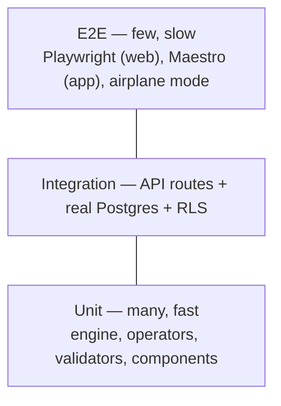

# TESTING — what we test, how, and what blocks a merge
*Project rule: engine/API changes ship with tests, and the real output is shown before anyone says "done".*

## 1. The pyramid

| Layer | Tool | Covers | Runs |
|---|---|---|---|
| Engine | Vitest + fast-check | 120 profile cases, operator property tests, three-valued logic, next-question picker | every push |
| API | Vitest + Fastify `inject` + Supabase local | every route, Zod 400s, idempotent `POST /screenings`, rate limit | every push |
| DB / RLS | SQL tests via Supabase local (pgTAP or Vitest) | worker A cannot read org B's screenings; anon cannot write schemes | every push |
| Pipeline | pytest | schema validator, quote check, eval metric maths on tiny fixtures | every push |
| Mobile | Jest + React Native Testing Library | screens, offline banner, queue logic | every push |
| Web E2E | Playwright | screening flow, language switch, review UI | PR to main |
| App E2E | Maestro (on Android emulator / phone) | language → questions → results, **airplane mode** | before a release |
| Load | k6 | warm vs cold p50/p95/p99 at 10/50 req/s | before publishing numbers |
| Accessibility | axe (web), manual TalkBack pass (app) | contrast, labels, focus order | before a release |

*Maestro choice is provisional — confirm Expo support via context7 when the app exists.*

## 2. The 120 profiles (engine truth)
- Written **by hand, before the engine code**, in `packages/engine/test/profiles/*.json`: `{ profile, expected: { eligible: [...], not_eligible: [...], ask_next: "field" } }`.
- Built per scheme: for each scheme, at least one clearly eligible, one clearly not, one on each **boundary** (age exactly 18 / 17; income exactly at the limit / ₹1 over), and one with a missing field.
- Plus persona profiles (Sunita, a Bengal student, a Marathwada farmer…) across all schemes.
- A failing profile is never "fixed" by editing the expectation unless the source text proves the expectation wrong — note the source line in the commit message.

## 3. Merge gates (GitHub Actions)
`lint → typecheck → unit + integration + pytest → build`. Red = no merge. Coverage target for `packages/engine`: 100% of branches (it is small; anything less means an untested rule path). No global coverage target elsewhere — test behaviour, not lines.

## 4. Checking AI-written tests
Red flags (see PLAYBOOK §6): tests that assert what the code does rather than what the spec says · expectations changed in the same commit as the code · mocks of the thing under test · snapshot tests nobody read. Ask "which line of DATA.md / the source text does this test prove?"

## 5. Real-device checks (manual, logged in `docs/qa-log.md`)
One low-end Android (2–3 GB RAM): cold start time, APK size, Marathi/Bengali text rendering and line height, read-aloud, offline result, TalkBack labels.

## 6. Security testing
Once SchemeMatch has a running staging deployment, a separate dedicated session will set up security testing of that staging app (Pranay's own app only).
